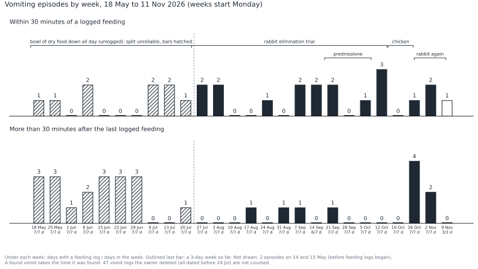
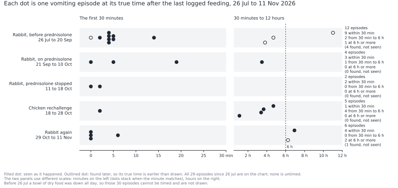
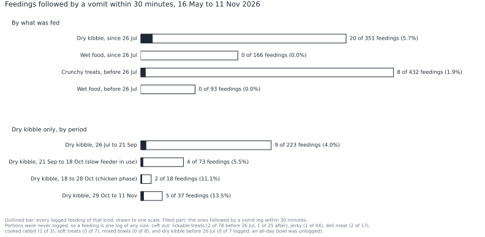

# Nyx, round 3: two kinds of vomiting, the whole cat, and what to ask on Saturday

**Date:** 2026-11-11 (record read to 11:30 CT). Issue: [CUL-2710](https://linear.app/projectnyx/issue/CUL-2710).
**Prepared for:** the PM, as Nyx's owner, then Nyx's vet (visit booked 2026-11-14).
**Companions:** [one page for the vet](./2026-11-11-round-3-vet-summary.md) · engine lessons from this round: [`docs/research/2026-11-engine-lessons-from-nyx-round-3.md`](../../research/2026-11-engine-lessons-from-nyx-round-3.md).
**Method in one line:** a data audit, five isolated specialist lenses, six literature lanes with every source opened and quoted, single subject statistics with the definitions written down first, a novelty audit by thirteen independent readers, and two adversarial passes on the load bearing claims.

> **What this is.** A read of one owner's app log for one cat. Nobody here examined her. Nothing below is a diagnosis, and nothing below tells you to start, stop or change a medicine or a food. Where a change might help, it is written as a question for her vet. "Dr. Chen" and every specialist lens in this document are personas run by a model, not veterinarians; any judgement that rests on a persona and not on a cited source is marked **[persona]**.
>
> **Privacy.** This repo is public ([CUL-2309](https://linear.app/projectnyx/issue/CUL-2309)). The file names no vet and no clinic, and the visit note is quoted with names removed.
>
> **The five inputs I asked for arrived blank** (what happened since 10-28, where the vet documents are, the question you most want answered, things noticed but never logged, what you are willing to change). I rebuilt what I could from the record and did not search Drive or Gmail, because nothing pointed me there. §12 lists the answers that would change this read the most.

---

## 0. Summary, in plain English

**Call the clinic before Saturday.** The last four weeks are her heaviest for vomiting since the trial began (13 episodes; her record high is 14, in May and June). The cough has met the vet's own September condition for a call. Ear drops were restarted on 11-09 without the clinic knowing. She has not been weighed in eight weeks, after a 15% drop. None of these is an emergency sign; all of them are things her vet should hear before she walks in. §1 has the detail.

**She has two kinds of vomiting.** One comes minutes after dry kibble: 18 times after 351 kibble feedings since the trial began, never after 259 wet feedings. The rabbit diet, the steroid and the slow feeder show no effect on it. (For 10 of the 18 the meal was logged at the same sitting as the vomit, which softens the statistics, not the direction.) The other comes hours after eating: 10 times, 4 of them in one bout on days 8 to 10 of the chicken challenge. That bout is real, and one bout cannot convict chicken.

**Nobody has seen whether the first kind is vomiting or regurgitation,** and that decides what the vet examines. "Eating too fast" is the usual explanation, and I could find no study that has measured it. What has been published links trouble at meals to the nose, the throat and the gullet. Film one event from first bite to the end.

**The diet trial has not shown a benefit.** The apparent drop sits in vomits that were found, not seen, in a two cat home. Going back to rabbit after chicken has not settled anything.

**The gut is not the only system.** A cough that eased on a steroid and returned, congestion, and ears that relapsed about six weeks after each course. Allergy, a polyp in the ear or behind the nose, and heartworm disease each fit parts of that. Nothing on record tests any of them.

**The weight loss is real.** 3.73 kg was the clinic's scale, and the clinic holds an earlier weight. The loss fits an unplanned calorie cut and fits disease equally. The clinic's earlier weights, a body and muscle score, and Saturday's weight separate the two.

**What I could not do:** read her two stored vet documents, see any lab result (none exists in the record), or say whose vomit a found vomit was.

---

## 1. Urgent items

Told to the PM during the session, before this report was finished, and repeated here so the report stands alone.

**Phone the clinic before the 11-14 visit.** The reasons, each from the record:

| What the record shows | Why it is worth a call |
|---|---|
| 13 vomiting episodes in the last 28 days (3.25 a week), 6 of them after chicken stopped on 10-28. Her first 12 weeks on rabbit ran 1.49 a week. Only her first four logged weeks hold more (14). Counting only vomits seen as they happened, the last four weeks are the highest in the record (12; the earlier maximum is 8). | The vet's last picture of her is from 09-16. The clinic can plan the visit (fasting, imaging, bloods) if it knows. |
| The 09-16 visit note: "if after the 10 days of full strength pred she's still coughing then we should give her a call". The 11-14 booking note: the cough "has returned" and is "daily, many times multiple times a day". | The vet set a condition for a call and the condition has been met. |
| Ear drops restarted 11-09 (twice on 11-10, once on 11-11). No call or visit is logged since 09-16. The name the record holds for the drops matches no product in the US label database; the nearest name is an ear suspension labelled for dogs only, whose label says not to use it when the eardrum is perforated (§13, row D1). Whether that is what she has is unknown. | Tell the clinic the drops were restarted and read them the label. Whether to keep giving them before the exam is the vet's decision. It turns on what is in the bottle and on an eardrum nobody has looked at since 09-16, and drops change what the vet can see and sample. |
| No weight since 09-16, eight weeks after a reading 15% below the one on file. | If you can weigh her at home today, do, and give the clinic the number. A reading at or above 3.73 kg clears nothing. A reading below it is a reason to call that day. |
| The app's read said "call your vet today" on six vomit logs between 10-26 and 11-07. No call is logged. | If a call happened and was not logged, disregard this row. |

One more thing to check, as a question for the vet or a pharmacist and not as advice: that the cetirizine she is given is plain cetirizine. Human allergy products are "often found in combination with pseudoephedrine, which can result in more serious clinical signs" (§13, row C14).

**Same day or emergency triggers.** This list is **[persona]**: it is carried from the 10-28 read with what the lenses added, and the clinic's own advice replaces it. None of these is logged today. A log with nothing in it is not a healthy cat.

- Open mouth or effortful breathing, at any rate
- No food for 24 hours, or clearly eating less for two days
- Three or more vomits in 24 hours; red or coffee ground material in vomit; black stool
- Hiding, hunched or flat (she was logged "hunched" once, on 09-25, after two bile vomits)
- String, fabric or rubber swallowed or seen in vomit or at the anus (non food material was read in or beside three of her vomits: 05-18, 07-09, 09-22)
- Head tilt or loss of balance, above all while on ear drops
- Can't keep water down, or retching with nothing coming up
- Pale or yellow gums

Worth a call, not an emergency: a breathing rate asleep that is above 30 a minute on repeated counts. Healthy cats at home sleep at about 20 (§13, row C12).

---

## 2. What is new in this round

Every finding is tagged against prior work: **NEW**, **EXTENDS** (the brief is named) or **CONTRADICTS** (the brief is named). A finding that only repeated an earlier brief was cut.

The tags are not mine alone. Thirteen independent readers each took one prior source (the six earlier briefs and brief pairs, the ruling sheet, the specs, the code and the tracker), read it in full, and returned the line that states, half states or contradicts each finding. That audit changed my first tags on F1, F4, F5, F7 and F8, and it caught a counting error in F15 (I had called the last four weeks equal to the record high; the June brief's count showed they are one short). Appendix A is the ledger of what each earlier read concluded.

### 2.1 From her record

| # | Finding | Tag |
|---|---|---|
| F1 | Since the trial began her episodes split into "within 30 minutes of a feeding" (19) and "later" (10), and the two behave differently across the chicken rechallenge and the return to rabbit. The chicken bout was all the later type (4 of 4). What continues is mostly the after kibble type (4 of 6, three of them resting on same sitting logs). Pooled rates by period hid this. | **EXTENDS** the August signals brief (a three way timing split, to 08-13) and the 10-28 panel (which saw that the chicken bout was all delayed). The counts since 07-26 and the behaviour after chicken stopped are new. |
| F2 | Within one diet line, 18 episodes followed 351 kibble feedings within 30 minutes and none followed 166 wet feedings (0 of 259 over the whole record). It holds stratified by time of day and matched by day. It weakens when only meals logged before the vomit count (8 against 0). It cannot separate dry form from the kibble's other ingredients, portion or speed. | **EXTENDS** the June council brief (4 of 4 after crunchy food against 0 of 49 "soft", graded noise) and the October engine brief (which noticed that nearly every timed vomit followed the dry trial food and treated it as a hazard of naming the food). The same diet contrast, both denominators, the stratified tests and the same sitting weakness are new. |
| F3 | The slow feeder, as used since 09-21, shows no detectable benefit (rate ratio 0.86, 95% CI 0.20 to 2.97). | **NEW** |
| F4 | The four later episodes of 10-26 to 10-28 are a real bout even after correcting for having picked the window afterwards (p about 0.006), but one bout lands inside a 10.4 day window by coincidence about 1 time in 10. A check for clustering elsewhere in her record found none and had 19 to 51% power to find any. | **EXTENDS** the 10-28 panel, which already showed the bout is unlikely at a constant rate and does not convict chicken. The window correction, the coincidence figure and the bout level comparison are new. The 10-28 line "vomiting clusters, so true probabilities are higher" is neither confirmed nor refuted. |
| F5 | Before the trial a bowl of dry food was down all day, she grazed from it, and none of it was logged. So "minutes since the last logged feeding" does not measure time since eating before 07-26, and any pre trial split by timing is unreadable. Her live record no longer holds the bowl at all. | **CONTRADICTS** the August signals brief, which split pre trial vomits by timing, called the late group "empty stomach" and "unambiguous", and built candidates on it. The same split is carried without the caveat in the September step change brief, the October engine brief and the 10-28 panel. The bowl itself is on file (the free feeding spec of June, the June council brief, the October engine brief), and the engine already drops a vomit under a recorded bowl; nobody had applied that to her whole pre trial era. |
| F6 | The fall in the later label dates to early July (95% interval 06-29 to 07-29; probability 0.96 that it came before the trial), and it looks like a change in labelling: the weekly total barely moved (3.0 to 2.1) while found vomits fell from 11 to 1. | **EXTENDS** the August brief (the mix shifted from about 07-09) and the 10-28 panel ("the decline began before rabbit"). **CONTRADICTS** the August brief's reading of that shift as a real change in her vomiting ("the empty stomach phenotype stopped"). The October engine brief had already found that "empty stomach bile" has no clean instance and that the second real kind is "found later"; the dated change and the found vomit explanation are new. |
| F7 | Three explanations for that fall were tested and failed: one treat brand ending on 07-05; shorter overnight gaps; ear drop courses. | (a) and (c) **NEW**. (b) **CONTRADICTS** the August brief, which said long overnight fasts became rarer on the trial. That brief counted main meals only; I counted every logged feeding and found the longest daily gap got longer (about 10 hours, from about 7). With an unlogged bowl down before the trial, neither count measures a fast in that era. |
| F8 | 3.73 kg on 09-16 was the clinic's scale (8.22 lb in the visit note), the note calls it "this loss", and the vet "wasn't very concerned", so the clinic holds an earlier weight. The app labels the reading "home scale". | **EXTENDS** the September step change brief, the weight lane spec and the ruling sheet, all of which already treat 3.73 kg as the clinic's number. **CONTRADICTS** the 10-28 read, which called both readings home scale and asked the vet for a clinic weight. The visit note's wording and the earlier clinic weight it implies are new. |
| F9 | The rate of loss under each possible date for the 4.40 kg reading (0.9%, 1.15% or 2.05% of body weight a week) against what supervised weight loss plans run at, with an energy reconstruction of 07-26. | **EXTENDS** the October engine brief and the ruling sheet (the size of the loss; treats falling to none; a generic 2% a week line for planned loss). The rates by date, the comparison and the arithmetic are new. |
| F10 | The cough is logged at a small fraction of its stated rate: 36 logs in 19 weeks against the owner's "daily, many times multiple times a day". No count in the log measures it. | **NEW** |
| F11 | The ears relapsed 37 and 43 days after each course of drops ended, and each ear episode began within about 36 hours of cough or sneeze logging restarting. | **NEW** |
| F12 | A cough or sneeze was logged between a kibble meal and a vomit twice (09-17, 11-11). Against a null that respects when the owner is watching, that is not more than chance (p = 0.23). | **NEW**. The August brief raised cough beside vomit as a topic; nobody had tested it. |
| F13 | No vet contact is logged between 09-16 and today, across the 10-28 "call today" read, and the vet's own September condition for a call has been met. | **NEW** |
| F14 | Since 08-17 only 8 of 481 feedings carry an intake rating. 17 of 35 doses hidden in wet food were logged "partial", which means the food was not finished. Those doses are the largest body of intake evidence in the trial era. | **EXTENDS** the September briefs and engine critique and the October brief (ratings stopped on 08-17) and the 10-28 panel (which read the partial doses as uneven dosing). Reading them as intake evidence is new for her record; the vet report already prints a partial dose beside its meal's rating. |
| F15 | The last 28 days hold 13 episodes, one short of the record high (14, 05-14 to 06-10) and the highest on record for vomits seen as they happened (12 against 8). The trial's apparent gain (rate ratio 0.54) depends on found vomits in a two cat home (seen only: 0.73, interval 0.33 to 1.61) and has not held. | **EXTENDS** the August, September and 10-28 reads, which called the gain suggestive and unproven (2.86 to 1.61 a week, one sided p 0.067, in the September critique). The seen only recount and the last four weeks are new. |
| F16 | Prednisolone shows no detectable effect on either kind of vomiting, and the course was far too short to show one (about 10% power to see a halving). The longest vomit free gap in the record sits inside the course and is unremarkable at a constant rate. | **EXTENDS** the 10-28 panel ("barely lower" on the steroid). The interval, the power and the gap test are new. |
| F17 | Two hypotheses nobody had raised: a growth or narrowing in the ear or behind the nose as one link between ear disease, congestion and trouble at meals; and medicating in her only permitted wet food as a risk to intake. | **NEW** **[persona]**, checked against the literature in §9. |
| F18 | 18 of 63 vomit logs are found vomits, 13 of them before the trial, in a home with a second cat. Found episodes are overwhelmingly the later label (15 of 17, against 14 of 40 seen). | **EXTENDS** the October engine brief (how many were found; a found vomit cannot be timed) and the September critique and incident spec, which record as a known limit that a found pile in a two cat home is credited to the pet on screen. Her counts and the link between "found" and "later" are new. The October brief counts unwitnessed vomits by timestamp confidence (20 of 49 to 10-09); I count the log's own "found" marker, so the two totals differ. |

### 2.2 From the literature

Every source was opened this round. Citations already used by an earlier brief are marked † in §13 and were reread, not reused.

| # | Finding | Tag |
|---|---|---|
| L1 | No study was found, in cats or dogs, that relates eating speed, food form, meal size or slow feeders to vomiting or regurgitation. The statements that link gorging to vomiting are expert opinion and cite no data. | **NEW** |
| L2 | Trouble at meals has published links to the nose, throat and gullet: regurgitation is often reported as vomiting in cats; a narrowing behind the nose came with regurgitation or vomiting in 6 of 15 cats; 9 of 31 cats with a hiatal hernia had airway disease. | **NEW** |
| L3 | Recurring ear disease in cats is led by allergic disease and polyps. Polyps are a young adult's problem (median age 2), show ear and airway signs together in 29%, and were visible on ordinary otoscopy in 13 of 37 cats, every one of whom had already failed topical treatment. | **NEW** |
| L4 | Heartworm disease in cats is "often misdiagnosed as asthma", eases on prednisolone, and lists "intermittent vomiting unrelated to eating" among its signs; 19% to about a quarter of infected cats were indoor only; no single test detects every case. | **EXTENDS** the 10-28 panel, whose emergency lens listed a heartworm test among baseline tests without saying why. The reasons are new. |
| L5 | A provocation that starts vomiting on day 8 lies outside what the feline gut studies found here measured: relapse came within 3 to 4 days in the one study, which stopped watching at day 7. Skin flares mostly come by day 7 and nearly all by day 14. Nobody has agreed how long to watch. | **EXTENDS** the August brief, which cited the same two papers † for how long a trial should run. The reading on time to relapse is new. |
| L6 | Foods labelled rabbit have repeatedly tested positive for chicken DNA, including a veterinary rabbit wet diet and both retail rabbit cat foods in one study. Whether traces matter clinically is untested. Her trial has used six rabbit products from at least three makers. | **NEW** |
| L7 | Owners rate improvement that measurement does not show (54 to 74% of placebo treated cats were owner rated successes against 10 to 63% by measured activity). The trial was closed on 10-20 as "improved" on the owner's impression, and "the steroid helped the cough" is the same kind of evidence. | **NEW** |
| L8 | The name the record holds for her ear drops matches no product; the nearest name is a dog only product. | **NEW** (the 10-28 read repeated the recorded name). |

---

## 3. The record, and what it cannot support

### 3.1 What was pulled

From production, read only, for the PM's cat alone (pet id ending `0042`). The QA clone of her record (frozen 08-02) and two test pets were excluded by id; the clone was consulted once, for a row her live record no longer holds (§3.5). Live rows only unless stated. Stored times are UTC and every time in this report is America/Chicago, the account's zone, converted in the query (the clocks changed on 11-01).

| Table | Rows used |
|---|---|
| `events` | 1,462 live, 05-14 to 11-11: 1,232 meals, 80 medication, 63 vomit, 36 cough, 21 sneeze, 18 daily looks, 6 itch, 3 other, 2 weight, 1 lethargy |
| `meals`, `meal_components`, `food_items` | every feeding with its food, format and ingredients; 8 mixed bowls |
| `event_ai_analysis` | a completed photo read for 56 of 63 vomit logs (two of those read "unsure" on every field) |
| `medications`, `medication_administrations`, `medication_items` | 2 courses, 139 doses |
| `weight_checks`, `pets.weight_kg`, `pet_weight_displacements` | 2 readings; no displacement rows |
| `vet_visits`, `vet_appointments`, `vet_documents`, `vet_calls`, `care_acknowledgements` | 1 visit with notes, 1 booked visit, 2 documents (metadata only), 0 calls, 3 acknowledgements |
| `diet_trials`, `diet_trial_foods`, `feeding_arrangements`, `intake_checks`, `looks`, `conditions`, `ai_signals` | 1 trial, 6 allowed foods, 1 arrangement (deleted), 3 intake answers, 18 looks, 0 conditions, the current Signal |

### 3.2 Coverage

Feeding logs exist on every day but one from 05-16 to 11-11 (09-20 has none). No logging gap hides a quiet week. Two vomits dated 05-14 and 05-15 predate feeding logs and were entered about ten days later from photos.

Whether the owner watching more closely makes vomit logs more likely was tested (H8, §5): it does not. Days in the top third for feeding logs carried 1.48 episodes a week, days in the bottom third 2.03.

### 3.3 Timestamps

- 40 of 63 vomit logs are marked seen as they happened; 18 are "found" and carry the time they were found; 3 are estimates and 2 are unmarked. Since September nearly every log is a seen vomit with a photo taken at the time.
- Feedings: on the trial, 328 of 351 kibble logs and 131 of 166 wet logs were made as the feeding happened. The rest were entered later, a median of two to three hours later.
- Of the 19 episodes since 07-26 that came within 30 minutes of a logged feeding, 8 had the meal logged before the vomit happened, 10 had the meal logged in the same sitting as the vomit (seconds before the vomit log), and 1 was back filled later. The comparison in F2 was rerun on the 8 alone (§5.3 A): the direction holds and the certainty does not.
- Recent kibble meals and the vomit after them often carry the same minute (0, 0, 2, 2, 0, 0, 0, 6 since 10-09, against 4, 4, 5, 2, 14, 5, 4, 4, 5 before). That reads as the meal being logged when the vomit was, not as her vomiting faster.

### 3.4 Deleted logs

47 vomit logs were deleted by the owner, all dated 05-14 to 07-23; 27 went in one sitting on 05-24. Only 5 sat within an hour of a surviving log, so most were not duplicates. Eight "loose stool" logs (05-20 to 06-13), one lethargy log and one itch log were deleted the day they were made or the next. No reason is recorded for any of them. The live pre trial record may under count, and no stool of any kind has been logged since 06-13.

### 3.5 The bowl nobody logged

Before the trial a bowl of dry food was down all day. Her live record no longer says so: the only arrangement row left is a duck kibble bowl, deleted on 07-02. The QA clone, frozen on 08-02, still holds a second row: Royal Canin Weight Care, free choice, 05-16 to 07-25, the day before the trial. The owner's later notes call that food "her sister's". The free feeding spec written in June (`docs/nyx-free-feeding-requirements.md` §1) describes the same bowl: shared, down all day, and grazed by her.

This matters twice. First, before 07-26 the time since the last logged feeding says nothing about the time since she ate, so the two timing types cannot be told apart in that era (F5). Second, a calorie source that was never counted disappeared the day the trial began (§8).

### 3.6 Two cats

The owner's notes mention "her sister", who eats a chicken based weight management kibble. Three trial breaches are logged (08-08, 08-12, 08-14: "a few bites" of that food). A found vomit in a two cat home cannot be pinned on one cat; 18 logs are found vomits, 13 of them before the trial. A profile named "Schrodingers Cat" on the same account looks like a test pet (it shares a vomit timestamp with Nyx's record) and was excluded; if it is the sister, tell me. The sister's own health is not in the record anywhere.

### 3.7 Intake

Portions were never recorded: all 1,232 feeding logs carry quantity "unknown". Ratings were kept until mid August and then stopped:

| Era | Feedings | Rated | All | Most | Some | Picked | Refused |
|---|---|---|---|---|---|---|---|
| Before the trial, 05-16 to 07-25 | 643 | 481 | 403 | 21 | 33 | 16 | 8 |
| Trial, first three weeks, 07-26 to 08-16 | 108 | 47 | 28 | 9 | 2 | 5 | 3 |
| 08-17 to 11-11 | 481 | 8 | 1 | 5 | 0 | 2 | 0 |

Trial day one (07-26) was rated picked, picked, refused, refused. That is an intake drop on the new food and it is a health signal, not fussiness. From 08-17 the record cannot say whether she is eating. The nearest thing to intake evidence in that stretch is the medication log: 11 of 15 prednisolone doses and 6 of 20 cetirizine doses given in wet food were logged "partial", meaning the food that carried them was not finished.

### 3.8 The cough

36 cough logs and 21 sneeze logs in 19 weeks. The owner's own words for the 11-14 visit: coughing "occurs daily, many times multiple times a day". The log holds one cough every 3.7 days against an owner's account of several a day, so it captures a small and unknown fraction. People report cough poorly even about themselves (§9.11). Every count of coughs in this report is a count of logs. Cough and sneeze only became loggable on 07-01, so the record cannot date their onset; cetirizine was first logged that same day.

### 3.9 Weight

Two readings, two scales, one of unknown date. Detail in §8.

### 3.10 Vet documents

Two files are stored: a prescription for the rabbit food (07-30) and the invoice for the 09-16 visit. Their contents sit in private storage that this session cannot open, so nothing was transcribed. No lab report, imaging report or discharge summary exists in the record, and the visit note mentions no test. The table the brief asked for (every lab value, weight, exam finding and diagnosis with date and source) therefore has four rows, all from the owner's 09-16 note:

| Date | Finding | Source |
|---|---|---|
| 09-16 | Weight 8.22 lb (3.73 kg), clinic scale; described as a loss the vet "wasn't very concerned about" | owner's visit note |
| 09-16 | No fever | owner's visit note |
| 09-16 | Lungs "sound good" | owner's visit note |
| 09-16 | Left ear "has dirt in it"; right "looks good"; previous ear infection was both ears | owner's visit note |

No diagnosis is recorded anywhere, in the note or in the app's conditions list.

### 3.11 What the record cannot support, stated once

- Whether any episode is vomiting or regurgitation.
- How much she eats, in any unit, since mid August.
- What she weighs now, and what the clinic weighed her at before September.
- Anything about stool, thirst, urine, breathing rate or effort.
- Which cat a found vomit came from.
- How often she coughs.
- Any cause. Every association below is one cat, watched by one person, with several things changing at once.

---

## 4. One timeline of every intervention

| When | What changed | Source |
|---|---|---|
| before 05-16 | No feeding logs. Two vomits (05-14, 05-15) entered later from photos. | events |
| 05-16 to 07-25 | **Pre trial.** About 9 logged feedings a day: about 7 treats (crunchy Temptations, Friskies Party Mix, Greenies; lickable Delectables; some deli turkey and rotisserie chicken) and 1 to 2 wet meals of rotating brands, mostly chicken. A bowl of Royal Canin Weight Care dry was down all day and never logged (§3.5). | meals; QA clone |
| 06-09 to 07-02 | A second all day bowl (duck kibble) is recorded, later deleted. | feeding_arrangements |
| 07-01 | Cough and sneeze first logged (the first day the app could log them). Cetirizine first logged, given in a lickable chicken treat. A chicken paté meal starts, 1 to 3 times a day. | events, medication log |
| 07-05 | Last Temptations feeding. | meals |
| 07-16 to 07-30 | Ear drops twice daily (ear infection, both ears per the later note). Implies a vet contact that is not in the app. | medication log; visit note |
| **07-26** | **Rabbit elimination trial starts**, vet directed, for the gut. Foods from here: Royal Canin Selected Protein PR dry (peas, rabbit meal, pea protein, coconut oil, hydrolyzed soy protein, vegetable oil, fish oil...) and PR wet; Instinct Limited Ingredient rabbit wet (water, rabbit, rabbit liver, chickpeas, guar gum...); rabbit jerky treats. Treats go from about 7 a day to almost none. The all day bowl ends. Logged kibble feedings go from almost none to about 4 a day. Day one is rated picked, picked, refused, refused. | diet_trials, meals |
| 08-01 to 09-05 | Cetirizine about every 3 to 7 days, in rabbit wet food. | medication log |
| 08-08, 08-12, 08-14 | "A few bites" of the sister's chicken kibble. | meal notes |
| 09-05 to 09-13 | Ear itch, ear held down, head shaking logged. | events |
| 09-16 | **Vet visit** (ear). Clinic weight 8.22 lb. Ear cleaned; ear drops once daily; prednisolone for the cough; trial extended from 8 to 12 weeks; "keep it to a single protein" when reintroducing. | vet_visits note |
| **09-21** | **Prednisolone 5 mg by mouth starts**: daily for 10 days, then every other day, 15 doses, the last on 10-10. 11 of 15 logged "partial". Ear drops once daily to 09-27. **A slow feeder** is introduced for dry food that evening. | medications, notes |
| 10-10 | Last prednisolone dose. | medication log |
| **10-18 15:13** | **Chicken rechallenge starts**, 8 days after the last steroid dose. Blue Buffalo Tastefuls purée (chicken broth, chicken, tapioca starch, vegetable oil, guar gum): 2, 3, 2, 3, 5, 2, 3, 3 a day to 10-25, then 1, 1, 0. Applaws chicken breast in broth (chicken, broth, rice): about 2 a day from 10-19, in mixed bowls with rabbit wet from 10-22. Rabbit foods continue. Kibble logs per day turn erratic: 4, 0, 1, 2, 0, 4, 1, 5, 2, 0, 1. | meals, meal_components |
| 10-20 | Owner closes the trial in the app: "improved ... mostly down to scarf and barfs now". | diet_trials |
| 10-25 | 11 feedings logged, the most of any trial day. | meals |
| 10-26 to 10-28 | Four vomits 1 to 5 hours after meals, in 54 hours. | events |
| **10-28** | **Last chicken feeding.** | meals |
| 10-29 on | Rabbit foods only. Two new rabbit products: Instinct rabbit paté (11-05 to 11-09) and one "small test amount" of KOHA rabbit (11-07). | meals |
| 11-01 on | Cetirizine about every 2 days. | medication log |
| 11-07 | Vet appointment booked for 11-14: "vomiting & congestion". From here logged kibble feedings fall to about 1 a day and wet rises to about 3. | vet_appointments, meals |
| 11-09 on | Ear drops again (third course). | medication log |
| 11-11 00:49 | Latest vomit, 6 minutes after kibble, two sneezes logged in between. | events |

Never logged at any point: a dewormer, an antiemetic, an antibiotic, a probiotic, or a parasite preventive.

---

## 5. The analysis

### 5.1 What was fixed before any test ran

Definitions were written down first (Appendix B) and taken from constants that existed before this session, so that no cut point could be chosen where the data looked best:

- **Episode:** vomit logs within 3 hours of the previous log are one episode (the engine's own rule). 63 logs, 59 episodes. At 90 minutes the count is the same; at 12 hours it is 52.
- **Type:** *within 30 minutes* if the last logged feeding was 30 minutes or less before the first log (the engine's rapid window), otherwise *later*. No episode since 07-26 falls between 19 and 58 minutes, so 15, 30 and 60 minute cuts give almost the same split.
- **Periods** are cut only at dates in the record: trial start, first and last steroid dose, first and last chicken feeding.

I had already read the raw rows when I wrote the definitions, so every test here is exploratory. Twelve hypotheses were registered; the pre registered family of ten tests carries a Holm correction. With the post hoc checks and sensitivity runs listed in Appendix C the session ran about 60 tests. The biostatistics lens put the number of comparisons this record invites at about 100. Read every p value below with that in mind: at that scale one striking contrast is expected by chance alone.

### 5.2 The picture





Episodes per week with exact 95% intervals. "Found" is the number of that period's episodes that were found, not seen.

| Period | Days | All | Within 30 min | Later | Found |
|---|---|---|---|---|---|
| Before the trial, 05-16 to 07-25 | 71.0 | 28: 2.76 (1.83 to 3.99) | split not readable | split not readable | 12 |
| Rabbit, before prednisolone, 07-26 to 09-20 | 57.0 | 12: 1.47 (0.76 to 2.57) | 9: 1.11 (0.51 to 2.10) | 3: 0.37 (0.08 to 1.08) | 4 |
| Rabbit, on prednisolone, 09-21 to 10-10 | 20.0 | 4: 1.40 (0.38 to 3.58) | 3: 1.05 (0.22 to 3.07) | 1: 0.35 (0.01 to 1.95) | 0 |
| Rabbit, steroid stopped, 10-11 to 10-18 | 7.6 | 2: 1.83 (0.22 to 6.62) | 2: 1.83 (0.22 to 6.62) | 0: 0 (0 to 3.38) | 0 |
| Chicken rechallenge, 10-18 to 10-28 | 10.4 | 5: 3.38 (1.10 to 7.88) | 1: 0.68 (0.02 to 3.76) | 4: 2.70 (0.74 to 6.92) | 0 |
| Rabbit again, 10-29 to 11-11 | 13.5 | 6: 3.12 (1.14 to 6.78) | 4: 2.08 (0.57 to 5.32) | 2: 1.04 (0.13 to 3.75) | 1 |

The last three rows are 8 to 14 days long and hold 2, 5 and 6 episodes. Their intervals run from below her quietest stretch to seven or eight a week.

### 5.3 What holds, what does not

Each row gives the test, the effect with its interval, every confounder I could name, and a verdict. Verdicts use the biostatistics lens's four words: supported, suggestive, not distinguishable from chance, not testable.

**A. Vomiting within 30 minutes of a meal follows kibble, not wet food. Supported, as an association.**



- 18 episodes after 351 kibble feedings (5.1%, 95% CI 3.1 to 8.0) against 0 after 166 wet feedings (upper bound 2.2%). Fisher exact p = 0.0013; Holm adjusted 0.012.
- Chance alone would put about 2 episodes within 30 minutes of a kibble log and about 1 within 30 minutes of a wet log. The record has 18 and 0.
- Stratified by time of day (wet food was fed in every six hour band): p = 0.0004. Matched by day, asking only whether the food before each episode was kibble given that day's mix: p = 0.0014.
- Co feeding cannot make the zero: a wet feeding in the half hour before any vomit would have counted, and none did.
- **What weakens it.** For 10 of the 18 episodes the kibble meal was logged in the same sitting as the vomit, after it happened. Counting only the 8 whose meal log came first: 8 against 0, p = 0.06 to 0.11. The direction never changes; the certainty does.
- **Confounders:** the dry and wet foods differ in more than form (the kibble carries pea protein and hydrolyzed soy; the wet food's ingredients are not on file); portion (never logged); speed; the wet food is what carries her pills; the feeder. Before the trial the same thing followed crunchy treats, deli meat and cooked rabbit, which argues for texture or speed over ingredient, but that era is the unreadable one.
- **What it cannot say:** whether these events are vomiting or regurgitation, and why they happen.

**B. The slow feeder. Not distinguishable from chance; no sign of benefit.**

- Within 30 minute episodes per week on rabbit: 1.04 with the feeder (4 in 26.9 days) against 1.21 before it (10 in 57.7 days). Rate ratio 0.86 (95% CI 0.20 to 2.97). Extending the window to today gives about 1.1.
- **Confounders:** it began the same day as prednisolone and ear drops; it was bought because of a bad week (two episodes on 09-17, one on 09-21), so some fall was expected anyway; how it is used at each meal is not logged; the owner's own note on 10-20 says they are "starting to get better about using it properly".
- A halving is not excluded. Neither is a doubling.

**C. Did the rabbit diet reduce her vomiting? Not shown.**

- All episodes: 1.49 a week on rabbit (18 in 84.6 days) against 2.76 before (28 in 71 days). Rate ratio 0.54 (0.28 to 1.01), p = 0.053.
- Counting only vomits the owner saw: 1.16 against 1.58, rate ratio 0.73 (0.33 to 1.61), p = 0.47. The apparent gain sits in found vomits, in a two cat home.
- The pre trial baseline is soft in both directions: 47 deleted logs (if the 42 that stand apart from a surviving log were real, the pre trial rate was 6.9 a week), and the pre trial weeks were also the owner's first with the app.
- Treats, the bowl, meal count, form and protein all changed on the same day.
- The registered test that "later" episodes fell on rabbit (rate ratio 0.18, p = 0.0005) is **disowned**: it compares a label that means something from 07-26 with one that does not before it (§3.5).

**D. The four vomits of 10-26 to 10-28. A real bout; its tie to chicken is suggestive at most.**

- Against a constant rate, four of her ten "later" episodes since 07-26 falling within 2.23 days has probability 0.006. At her rabbit phase rate, four or more in any given 10.4 days has probability 0.002. No 10.4 day stretch of the first rabbit phase held more than two.
- But it is one bout. A single bout dropped at random into the 108 days since the trial began lands inside a 10.4 day window about 1 time in 10. Counted as bouts, chicken against rabbit is 1 against 3 or 4: rate ratio 2.0 to 2.7, p about 0.4.
- **Confounders:** 8 days off prednisolone when chicken began, 16 when the bout began; three new ingredients besides chicken (rice, tapioca, a new format); logged feedings up from 4.8 to 7.4 a day and 13 in the 24 hours before the first vomit; kibble erratic; an owner watching for exactly this.
- The registered rate test gives 8.2 (1.5 to 43.8), p = 0.007, Holm 0.055. That number treats four vomits in one bout as four independent events and should not be quoted alone.

**E. Has going back to rabbit settled it? No call, and it cannot become "yes".**

- "Later" episodes since 10-29: 2 in 13.5 days (1.04 a week). The rule written in advance: at or below the rabbit phase rate (0.33) counts as responded; at or above half the chicken phase rate (1.35) counts as did not respond; between is no call. It is between.
- Three of the four "within 30 minutes" episodes in this stretch (10-31, 11-03, 11-04) have the meal logged in the same sitting as the vomit. If she had not in fact just eaten, they belong in the "later" column, the count becomes 5, and the rule reads "did not respond". If the found vomit of 11-08 ("found right by food, maybe a scarf and barf") was a kibble event, the count becomes 1 and the rule still reads no call.
- So the honest range is from no call to did not respond. No reading of these two weeks supports "responded".

**F. Prednisolone. Not testable.**

- Rate ratios on the steroid against before it: 0.95 for both types, with intervals from 0.02 to 11.8 ("later") and 0.17 to 3.81 (within 30 minutes). Power to see a halving on a 20 day course was about 10%; to see a 75% cut, about 20%.
- The longest vomit free gap in the record (13.8 days, 09-25 to 10-09) sits inside the course. Under a constant rate a gap that long somewhere in 12 weeks has probability 0.64. It proves nothing.
- 11 of 15 doses were partial, so how much she received is unknown.

**G. Are the after kibble events getting more frequent? Per week: not distinguishable. Per feeding: not interpretable.**

- Per week across the first rabbit phase there is no trend (p = 0.77). The 13.5 days since chicken stopped hold 4 where 2.2 were expected at that phase's rate (p = 0.19).
- Per kibble feeding the share rises: 4.0%, 5.5%, 5.6%, 10.8%. That is not a finding. Logged kibble feedings fell from 3.9 a day to about 1 as the slow feeder arrived and, lately, as wet food took over; and recent kibble logs are often made because of the vomit. Drop the same sitting logs and the trend goes (p = 0.24).

**H. When did the "later" label fall? Early July, and it looks like relabelling.**

- One change in rate, flat prior on the date: most likely 07-05, 95% interval 06-29 to 07-29, probability 0.96 that it preceded the trial.
- Across that date the total barely moved (3.0 a week to 2.1) while found vomits went from 11 to 1 and the mix flipped from 18 later and 4 within 30 minutes to 1 and 5. The series of all episodes shows no dated change at all (95% interval 05-24 to 10-02).
- A flipped mix on a steady total is what a change in logging looks like. Early July is when the duck bowl ended, feeding logs peaked at about 11 a day, and found vomits stopped being logged. This step is not evidence about her vomiting in either direction.

**I. The last four weeks. Supported, and it is the calm reading that would be wrong here.**

- 13 episodes in the 28 days to 11-11. Only one stretch of the record holds more: 14 in her first four logged weeks (05-14 to 06-10), before the trial. An earlier draft of this section called the two equal; the novelty audit caught it against the June brief's count and the recount confirmed 14.
- Counting only vomits the owner saw, it is 12, and that is the highest in the record as it stands: the pre trial maximum is 8.
- "As it stands" matters. 47 vomit logs dated before 07-24 were deleted, so nobody can say what the true May and June peak was. The claim that survives is narrower and still serious: the last four weeks are as heavy as anything since the trial began, close to her heaviest logged weeks, and not improving.
- Rabbit again against before the trial: rate ratio 1.13 (0.38 to 2.78); seen only, 1.65 (0.47 to 4.70).

**J. Clustering. Not detected, and the test could not have detected much.**

- Inside stable periods her weekly counts are no more variable than a constant rate (variance to mean 0.58 to 0.91) and short gaps are no more common than expected.
- With 12 weeks at 1.5 a week that test fires 19% of the time when the weekly rate truly varies by half, and 51% of the time when it varies by 100%. So this is "none detected", not "none".

**K. Does watching more closely produce more vomit logs? No.** Spearman −0.03 between a day's feeding logs and its vomit episodes. Vomit counts do not ride on logging effort. Cough counts do (§3.8).

**L. Cough or sneeze just before a vomit. Not distinguishable from the owner's logging sessions.**

- 09-17: kibble 17:07, cough 17:09, vomit 17:11. 11-11: kibble 00:43, sneezes 00:43 and 00:48, vomit 00:49. A third cough (09-04, 06:22) sits inside the hour in which a bile vomit was found.
- Of 57 cough and sneeze logs, 3 were followed by a vomit log within 15 minutes. Feeding logs, the moments the owner is known to be watching, are followed that often 2.9% of the time, which predicts 1.7. p = 0.23 (0.49 counting the two 11-11 sneezes once).
- Among kibble feedings, 2 of 18 that preceded a vomit also had a cough or sneeze log, against 3 of 333 that did not (p = 0.02, not corrected, and an owner who has just seen a vomit looks harder). Enough to aim a camera. Not enough to name a mechanism.

**M. The cough and the steroid.** Days with a cough or sneeze log: 2.58 a week before prednisolone, 1.40 on it (rate ratio 0.54, 0.14 to 1.61), 0.75 from 10-11 to 11-07, 5.25 since 11-08. The direction matches the owner's account that it helped and then wore off. The numbers measure logging.

**N. Explanations that were tested and failed.**

| Tempting story | Test | Result |
|---|---|---|
| One treat brand drove the hours later vomits (Temptations ended 07-05, the day the label fell) | "Later" episodes on days with or after a Temptations feeding against days without, to 07-05 | 2.33 a week exposed, 3.18 unexposed. No. |
| Long overnight gaps with an empty stomach drove them | Longest daily gap between feedings by week | The gap got longer on the trial (median about 10 hours, from about 7) while the type got rarer. No. |
| Ear drops make her nauseous (two bile vomits fell inside the September course) | Episodes on ear drop days against other days | All episodes: rate ratio 1.03. Bile episodes only: 2.8 (0.6 to 10), p = 0.09, post hoc. Not supported. |
| Afternoon kibble is riskier | Kibble feedings 12:00 to 17:59 against other hours | 9.6% against 4.0%, p = 0.047, post hoc, one of many cuts. Noise until it repeats. |
| Kibble eaten alongside wet food is safer | Kibble logged within 15 minutes of wet food against kibble alone | 0 of 25 against 20 of 326, p = 0.38. Too few to say; worth watching. |
| Ear weeks are cough weeks | Cough and sneeze logs in weeks with an ear sign or course against other weeks | 3.2 against 2.7, p = 0.36. Not at weekly grain; see §6 for the finer pattern. |

---

## 6. Clinical reasoning, before the literature

Five lenses read the same evidence pack: the record and the timeline as neutral tables, with no earlier brief, no interpretation of mine and no sight of each other. Each returned a ranked differential, the evidence for and against each entry, the one test or observation that would move it most, and an attempt to break its own lead. A sixth, clinical pathology, was not run because the record holds no lab result. **Everything in this section is [persona]:** a model reasoning in a specialist's role from general clinical knowledge. §9 says which of it the literature supports.

### 6.1 The five reads

| Lens | Gestalt | What it put first | The one test it wanted most |
|---|---|---|---|
| Feline internal medicine | Three chronic relapsing problems (gut, airway, ears) and a clinic recorded weight drop, with no blood, stool, parasite or imaging result on file. Saturday is a work up visit, not a recheck. | Asthma or chronic bronchitis in an allergy prone cat, with allergic ear disease; then a diet to steroid responsive enteropathy; then the dry food events | Chest radiographs |
| Gastroenterology | At least two behaviours: a food only expulsion minutes after dry food that has ignored the trial, the steroid and the slow feeder; and a delayed, sometimes bilious type. "Scarf and barf" may be part of this; the record does not let anyone stop there. | For the after kibble type: rapid eating, then an irritable stomach from the disease behind the other type, then oesophageal disease. For the delayed type: food responsive enteropathy, then steroid responsive enteropathy, then retained foreign material | A video from first bite to expulsion |
| Nutrition | On 07-26 the diet changed in every dimension at once and the only weight since is 15% lower: the trial controlled the antigen loosely and energy not at all. | Dry form meal mechanics, on an energy deficit that may be driving speed | The 11-14 weight against 09-16, with weighed intake |
| Generalist, outside the gut | Two or three processes. Ears and airway behave like one steroid responsive disease; vomiting keeps its own clock; the weight is explained by neither. | Allergic disease of ear, nose and bronchi; then a structural link from ear to the back of the nose (polyp, narrowing, foreign body); then parasites | A sedated look above the soft palate and at both eardrums |
| Biostatistics | One association holds (kibble against wet). Every before and after contrast is confounded, underpowered or both. | No clinical ranking | A designed comparison (§11.3) |

### 6.2 Where all of them agreed, unprompted

1. **Phone the clinic before the visit.** All four clinical lenses led with it.
2. **The after kibble events do not track protein.** They followed chicken treats, the sister's chicken kibble, rabbit jerky and rabbit kibble alike, and never wet food. The adversarial pass narrowed this: every one of those foods is dry, and the pre trial part of the list comes from the era whose timing cannot be read, so the record separates wet from dry and does not separate form from ingredient.
3. **Nothing the owner has tried has moved them:** not the rabbit diet, not the steroid, not the slow feeder.
4. **No baseline exists.** Six months, four body systems, and not one blood, stool, parasite or imaging result in the record. A steroid eases several of the candidate causes alike and can blur later tests, so the order of tests and treatment matters.
5. **The weight needs three facts the clinic holds:** its earlier weights, a body condition score and a muscle condition score.
6. **A video is worth more than any further log.** Vomiting against regurgitation decides whether the stomach, the oesophagus or the throat gets worked up, and the record cannot tell them apart.
7. **Intake is unknown, and unknown is not normal.**

### 6.3 Where they disagreed

Kept visible, not averaged away.

- **What leads the whole cat.** Internal medicine and the generalist put allergic airway and ear disease first and treat the gut as a second problem. Gastroenterology keeps the gut first and files the airway under "outside the gut is live". Nutrition puts feeding mechanics and energy first. These are not the same visit: the first asks for chest films and an ear and throat exam, the second for bloods and abdominal imaging, the third for a scale and a feeding plan.
- **Whether "scarf and barf" is enough.** Nutrition ranks it first. Gastroenterology: "'A is harmless scarf and barf' does not survive the slow feeder numbers." Internal medicine: fast eating "is common lore on thin evidence". The adversarial reviewer added that undigested food within minutes of kibble, a daily cough, non food material and a weight drop together are not excluded as regurgitation or something beyond fast eating by anything in this dataset.
- **What the chicken bout means.** Gastroenterology calls the delayed type "diet associated" and no more. Nutrition says it fits a food responsive relapse "and equally steroid washout, overload, or her September clustering". Internal medicine reads the two delayed episodes since chicken stopped as pointing toward a steroid responsive or non dietary disease. Biostatistics: "one cluster, one exposure".
- **The weight.** Nutrition: an unintended calorie cut fits the timing and the size. Internal medicine: "she lost at dieting speed without being dieted". The generalist: neither the allergy story nor the diet story explains it, and "the unexplained weight is where a second disease would hide".
- **Ear treatment as a cause of nausea** (gastroenterology's fifth entry). Tested in §5.3 N and not supported.

### 6.4 What each lens tried to break, and whether it held

| Lens | Its lead | The counterexample it chose | Outcome |
|---|---|---|---|
| Internal medicine | One allergy prone cat explains airway, ears and gut | The after kibble events: unchanged on prednisolone and tied to food texture. "Allergy does not care about food texture, and it does not remove 15% of body weight." | Survives for airway and ears, weakened for the delayed vomits, **fails as a single explanation** |
| Gastroenterology | Two drivers: the after kibble type is protein independent; the delayed type is a diet responsive gastro enteropathy | 09-25: 19 minutes after rabbit kibble, bilious, twice, hunched, in trial week 9, on daily steroid | The split survives as description; "diet responsive" survives **only as diet associated** |
| Nutrition | Most ongoing vomiting is dry form mechanics on an energy deficit, not chicken | 10-27 and 10-28: delayed vomits 24 and 40 hours after the last kibble | Survives for the after kibble type; **fails as a single cause**; the hunger half is untested |
| Generalist | Ears and airway are one steroid responsive allergic disease; the gut is a second problem; the weight belongs to the gut | August: the loudest airway month, with silent ears. And the weight, handed to a feeding side nobody measured | Survives as the most economical reading, "not a safe one" |

### 6.5 Three things the lenses raised that no earlier read had

1. **A link behind the nose.** A polyp or a narrowing at the back of the nose would tie a relapsing ear, congestion and sneezing, and trouble at meals into one lesion. It is a recognised young cat problem [persona]; §9 gives what the literature says about how it presents.
2. **Her only permitted food is also her pill pocket.** 17 of 35 doses hidden in rabbit wet food were not finished. A bitter tablet in the one wet food she may eat risks teaching her to avoid it [persona].
3. **The basics nobody recorded.** Whether she goes outdoors, hunts or chews plants; vaccination; FeLV and FIV status; any flea, worm or heartworm prevention; whether her sister coughs, sneezes or vomits. A vet takes these in the first five minutes, and several candidate causes turn on them.

---

## 7. Ranked hypotheses

These are hypotheses for her vet to test, in the order I would want them addressed. The confidence column is my judgement after reconciling the lenses with the statistics and the literature **[persona]**. It is not a measurement and it is not a diagnosis. Row codes such as A11 or C4 point at the evidence table (§13). "What would change my mind" is the cheapest observation that would move the entry most.

### 7.1 The after kibble events (18 of 29 episodes since 07-26)

| # | Hypothesis | For | Against | Confidence | What would change my mind |
|---|---|---|---|---|---|
| R1 | **Meal mechanics:** she eats dry food fast or in volume and it comes straight back. Possibly sharpened by hunger after a calorie cut. | Only after dry or chunky food, never wet; minutes after eating; food, no bile; the owner's own words; the same pattern on crunchy treats before the trial | The slow feeder has not helped; the gap since the last meal makes no difference (so simple hunger is not supported); it does not explain the weight unless she is also under fed. No study was found that measures this explanation: it rests on expert opinion (A5, A6) | The most likely single explanation on how common it is thought to be, about even odds. The literature neither supports it nor ranks it | A video showing a passive, tube shaped return (points to R2), or events continuing after small, slow, weighed kibble meals |
| R2 | **Gullet or throat:** inflammation, a narrowing, a hiatal hernia, or something at the back of the nose or throat that makes swallowing dry food provoke a gag | Solids only; immediate; no bile; two events with a cough or sneeze in between; a weight drop; ears and airway unexplained. Published: 5 of 33 cats with gullet disease had been referred as vomiting (A1); a narrowing behind the nose came with regurgitation or vomiting in 6 of 15 cats and trouble swallowing in 6 (A11); 9 of 31 cats with hiatal hernia had airway disease (A2) | Intermittent (about 1 kibble meal in 20), where a fixed narrowing would be expected to fail most solid meals **[persona]**; disease behind the nose groups with noisy breathing and the absence of sneezing (A12), and she sneezes | Lower than R1, and the entry with published support for this combination of signs. The one not to miss: perhaps 1 in 4 | The video; a kibble swallow study; a sedated look at the throat and above the soft palate |
| R3 | **A stomach made irritable by whatever drives the later vomits**, emptying when it is stretched | Both types rose together in the last four weeks | The after kibble type did not fall when the later label did in August | Possible; cannot be separated from R1 without treating the other type | The after kibble events fading once the later type is controlled |
| R4 | **A coughing or sneezing fit ending in a vomit** | 09-17 and 11-11. Review opinion: in coughing cats, bouts of coughing often come straight before a vomit, and owners mistake one for the other in both directions (C9) | Two instances; most events have no cough log near them; the timing test is null; no study was found that counts it (C9 is opinion) | Unlikely as the main driver; worth one video | A cough or sneeze visibly starting the event on film |

### 7.2 The hours later episodes (10 since 07-26, four of them in one bout)

| # | Hypothesis | For | Against | Confidence | What would change my mind |
|---|---|---|---|---|---|
| D1 | **A chronic inflammatory gut disease that is not purely about diet** (steroid responsive or mixed) | September on strict rabbit ran as high as before the trial (9 episodes in 22 days, four with bile) and came with an ear flare; the heaviest four weeks since the trial began are now, on rabbit (13 episodes, against a record high of 14 before it); the weight. Weight loss "is the most common clinical sign" of chronic gut disease in cats and "often is overlooked" (E8) | No test has looked; the steroid course shows no detectable effect on vomiting, and was too short to show one | Leading entry for this type; not better than even | The baseline the consensus calls for: bloods ("always required") and abdominal ultrasound ("a critical step") (B7). Low cobalamin, an abnormal scan, or continued later vomits on a single clean diet would raise it |
| D2 | **A reaction to something in the chicken challenge** (chicken, rice, tapioca, or the load) | A real bout on days 8 to 10 and nothing like it on rabbit; it ended the day chicken stopped. Food sensitive cats can vomit hours after eating (B2) | One bout; a 1 in 10 coincidence; 16 days off steroid; the heaviest fed day on record came just before it; two later vomits since. In the one feline gut study relapse came within 3 to 4 days and watching stopped at day 7, so a day 8 start is unstudied (B1). Chicken was the named culprit in 1 of 16 cats there (it was also the trial diet for most of them, so under tested) and in 5% of 78 in pooled skin data; rice relapsed 4 of 9 cats in one trial (B2, B5) | Suggestive; perhaps 1 in 3 | The same lag again on a clean, single ingredient repeat. One repeat is not enough (§11.3) |
| D3 | **Something swallowed that is not food**, or hair, sitting in the stomach | Photo reads of non food material on 05-18, 07-09 and 09-22; hair in four vomits; undigested food 3.4 hours after kibble on 10-26; 09-22 was followed by bile vomits and "hunched". Cats that chew or eat non food items vomit more often (59% against 31%), and all 8 fabric eaters given a full gut work up had abnormalities (D13) | Photo reads are soft; the owner corrected two of the three; the D13 studies cannot say which came first | Lower, but cheap to check and serious if present | Abdominal imaging |
| D4 | **Parasites**, including the ones a routine stool test misses | No preventive or dewormer ever logged; a young cat; cough and vomiting together. Stomach worms were found in 4 of 131 gastric biopsies and are hard to find in stool (B11) | Nothing specific; lifestyle unknown; each is uncommon in absolute terms | Unknown, not low: untested | Stool tests, a heartworm test (W3), and a look at any vomit for worms |
| D5 | **Unscreened systemic disease** (kidney, liver, pancreas, retrovirus, lymphoma, a young cat's fibrosing gut disease) | A weight drop with vomiting; no bloodwork exists; one young cat gut entity carries weight loss in 60% and chronic vomiting in 37% (B13) | Her age argues against most of these: low grade gut lymphoma "is very uncommon in cats under 8" (E8) | Low, and a low prior is not a negative test | Blood count, chemistry, urine, FeLV and FIV |

### 7.3 The whole cat

| # | Hypothesis | For | Against | Confidence | What would change my mind |
|---|---|---|---|---|---|
| W1 | **One allergy prone cat:** airway and ears are one steroid responsive allergic disease; the gut may share it through a food allergy | The cough eased on the steroid and came back; ears relapse about six weeks after each course; ear itch; one back scratch; cetirizine was already being tried in July. Allergic disease led the causes in 103 referral cats with ear disease (D4); the expert naming groups skin, gut and airway allergy as one syndrome (D10); asthma is diagnosed from 1 year old (C1) | The ears relapsed in trial week 6 on strict rabbit; vomiting did not move on the steroid; allergy does not explain a 15% weight drop. Nobody has shown that ear, airway and gut disease occur together more than chance; the counts are uncontrolled (D10) | The most economical reading for ears and airway; not for the whole cat | Chest radiographs and a blood count; ear cytology. A chest that sounds normal does not rule asthma out: listening was normal in about 20 to 41% of affected cats and radiographs in 6 to 23% (C2) |
| W2 | **A polyp or narrowing in the ear or behind the nose** | The left ear relapsing; "tipping ear down"; congestion; a sneeze between kibble and vomit; partial steroid response. Polyps are a young adult's disease (median age 2); 29% show ear and airway signs together; all 37 cats in one series had failed earlier, mostly topical, treatment; ordinary otoscopy saw the mass in 13 of 37 (D7, D8). Middle ear disease and lower airway disease travel together on CT (D12) | Both ears were involved in July; the right ear looked normal on 09-16; she sneezes, where disease behind the nose groups with the absence of sneezing (A12) | Lower than W1, and the one an ordinary exam is most likely to miss | A sedated look above the soft palate and at both eardrums; imaging of the middle ears |
| W3 | **Parasites** (heartworm, lungworm, roundworm, ear mites) | Cough with vomiting and weight loss; "dirt" in the left ear; two cats; nothing preventive on record. Heartworm disease in cats is "often misdiagnosed as asthma", eases on prednisolone, and "intermittent vomiting unrelated to eating" is one of its signs (C3, C4). 19% to about a quarter of infected cats lived wholly indoors (C5). Ear mites were found in 6% of owned cats, half of them indoor cats with no signs (D5) | No lifestyle data; uncommon in absolute terms (antibodies in 2.7% of healthy pet cats in the US Midwest and 3.8% in the South; antigen in 1.0% of cats with respiratory disease) (C7); lungworm is rare in US laboratory data (C8) | Untested. Cheap to test and it changes everything if positive | A heartworm antibody test with an antigen test, since "no single test will detect all heartworm cases" (C6); stool tests including a Baermann; ear swabs; ideally for both cats |
| W4 | **Separate common problems** that happen to share a cat | Each is common alone; vomiting and cough logs run apart week by week | Ears and airway restarted together three times out of three | Cannot be ranked without tests | Any single test above coming back positive |

The order above is not the order of likelihood alone. D3, D4, W2 and W3 sit lower on probability and higher on what is lost if they are missed, and each has a cheap test.

**What the literature changed.** Three entries moved after the sources were read. R2 moved up: no study was found behind the usual explanation for the after kibble events, and the unusual one has case series that match her combination of signs. W2 moved up for the same reason and because, in the one series that counted, an ordinary ear exam saw only 13 of 37 polyps. W3 moved from "unlikely in an indoor cat" to "untested": the guideline's description of feline heartworm disease reads like her record, and indoor cats are a fifth to a quarter of cases. None of these is a likelihood for her. They are reasons the tests are worth asking about.

---

## 8. The weight

The weight gets its own section because every lens stopped on it, because it is the one finding that could be a second disease hiding behind the vomiting, and because three facts the clinic already holds would settle most of it.

### 8.1 What is on file


| Reading | Where it comes from | What is known about it |
|---|---|---|
| 4.40 kg (9.70 lb) | On her profile since 05-17. Entered again on 10-09 as a weigh in dated 06-15 and labelled "home scale". | The date she was weighed is not recorded. Earlier documents call it a home weight from June, and the September brief records the PM's confirmation that it was a real weigh in. |
| 3.73 kg (8.22 lb) | The 09-16 vet visit. The owner's note gives 8.22 lb and the vet's view of it. | Clinic scale. The app stores it as "home scale" because every reading entered before the source field existed was labelled that way. |

The difference is 0.67 kg, 15.2%. Two readings on two scales cannot show a trend, and nothing has been recorded in the eight weeks since.

The visit note is the most informative line in the record on this (names removed): the weight was "8.22 lbs", the vet "wasn't very concerned about this loss" and "said we could increase her food intake as needed. I explained that was tough". Two things follow. "This loss" means the vet was comparing with a weight of the clinic's own. And the owner told the vet that getting more food into her was hard, which is an intake problem said out loud six weeks into the trial.

### 8.2 How fast

The speed depends on when the 4.40 kg was true.

| If she weighed 4.40 kg on | Weeks to 09-16 | Loss per week |
|---|---|---|
| 05-17 (when it went on her profile) | 17.4 | 0.9% of body weight |
| 06-15 (the date later entered) | 13.3 | 1.15% |
| 07-26 (the day the trial began) | 7.4 | 2.05% |

For scale, from cats put on a diet on purpose and under supervision (E5, E6): plans aim at about 1% a week, with 0.5 to 2% as the working range; programmes that measured it achieved 0.7 to 0.9% and added food back when loss passed 1.5 to 2% a week; cats fed a quarter of their needs lost 3.2 to 3.5% a week and 3 of 24 developed fatty liver. So on any of the three dates she lost weight at the speed of a deliberate diet, and on the last date at the top of what a supervised plan allows. Nobody put her on one.

No guideline opened gives a number at which unintended loss becomes significant. Both nutrition guidelines list "unexplained weight change" as a reason for a fuller assessment (E7).

### 8.3 What changed in her bowl on 07-26

Everything, on one day (§4): about seven treat feedings a day stopped, an all day bowl of weight management kibble went away, and she moved to measured meals of a food she picked at and refused on day one. Portions were never logged, so what follows is arithmetic from labels, not a measurement. It is marked as an estimate wherever it appears.

- **What 0.67 kg is worth:** about 5,200 to 5,800 kcal **[estimate]**.
- **If all of it went after 07-26** (52 days): a shortfall of about 100 to 110 kcal a day. A cat her size needs somewhere around 180 to 235 kcal a day by the guideline formulas (E4), so she would have been eating about 80 to 130 kcal a day, roughly half of what she needs, and below the amount the food's maker prints for a 4 kg cat (146 to 195 kcal a day, E3).
- **If it went over the whole 17 weeks:** a shortfall of 43 to 49 kcal a day.
- **If she ate the printed amount and no treats:** a loss of 0 to 13% in those 52 days. The upper end of that reaches most of what was measured, with no disease at all.
- **What the treats were worth:** seven treat feedings a day comes to anywhere from about 9 to 97 kcal a day, depending on how many pieces a "feeding" was (E1). That range runs from nothing to half the shortfall, which is why "what is a feeding" is in §12.
- **The bowl:** the kibble that was down all day carries 3,209 kcal a kilogram (E1). How much of it she ate was never counted.

Free choice feeding and frequent treats both push weight up in cats (E13). Taking both away at once is, in effect, a diet.

### 8.4 Three readings of the loss

They are not exclusive, and the record cannot choose between them.

| Reading | What fits | What does not | What it predicts on Saturday |
|---|---|---|---|
| **An unplanned calorie cut.** She was a heavier cat on free choice food and treats, and the trial removed both. | The timing; the size (within what the printed amount alone predicts); day one rated picked, picked, refused, refused; 17 of 35 doses in wet food left unfinished; the owner telling the vet that feeding her more "was tough" | Nothing in the record contradicts it. Nothing measures it either | A body condition score near the middle of the scale, normal muscle, and a weight that has held or risen since kibble meals settled |
| **Disease.** Weight loss "is the most common clinical sign" of chronic gut disease in cats and "often is overlooked by clients or even veterinarians" (E8). | Ongoing vomiting; the heaviest four weeks since the trial began; no bloodwork to rule out anything else | Her age argues against the worst causes (E8) | Muscle loss on the muscle score, since disease takes muscle where simple underfeeding takes mostly fat (E10); a weight that has kept falling |
| **Measurement.** Two scales, and one reading of unknown date and origin. | If the 4.40 kg was an estimate, owners land within 10% of the true weight only 59% of the time (E12) | The PM confirmed it as a weigh in; the vet called the September reading a loss against the clinic's own number | The clinic's earlier weights showing a smaller drop than 15% |

A 15% change is worth about 1.2 to 1.8 points on the nine point body condition scale (one point is 10 to 15% of body weight, E9). If she was a 6 or 7 in the spring, she is about a 5 now, which is where a cat should be. If she was a 5, she is now a 3 or 4, which is thin. The clinic scored her, or can.

### 8.5 What separates them, all of it free on Saturday

1. **The clinic's earlier weights, with dates.** They exist: the vet compared against one.
2. **A body condition score and a muscle condition score.** Muscle is scored apart from fat because "animals can have significant muscle loss even if they are overweight" (E10). Body condition is recorded at only about a fifth of cat visits (E11), so it is worth asking for by name.
3. **Her weight now, on the clinic's scale.** Eight weeks on, this is the single most informative number available. Held or up points toward the calorie cut. Down again, on kibble meals, points away from it.
4. **One week of weighed food**, before or after the visit (§10).

### 8.6 Where the lenses disagreed

Nutrition read an unintended calorie cut that fits the timing and the size. Internal medicine: "she lost at dieting speed without being dieted". The generalist: neither the allergy story nor the diet story explains it, and "the unexplained weight is where a second disease would hide". All three are **[persona]**. The literature does not rank them. It does say the question is routinely missed (E8, E11).

### 8.7 Why this sits under every feeding question

Every change anyone might suggest for the after kibble events (wet food only, smaller meals, a different product) changes how many calories she takes in. Wet food carries fewer calories per mouthful than kibble, and the chicken foods used in the rechallenge are not complete diets at all (E2). With a 15% drop on file and intake unmeasured, a feeding change made without the vet could deepen a loss nobody is watching. That is why §11 puts every one of them to the vet as a question.

---

## 9. What the literature says, and where it is silent

Six lanes of reading were set by the differentials in §6 and §7, not the other way round. Every source was opened this round and every quotation was matched against the opened page; nothing is cited from memory. Where only the abstract could be opened, the evidence table says so. The table (§13) holds 89 rows: the claim, a quotation or figure, the species, the design, the sample size, a DOI or PMID, a grade, and how it was read. Grades: **F** a primary study in cats; **X** carried over from dogs or people; **E** expert opinion or review; **G** a guideline or consensus; **L** a product label. The rows draw on about 160 sources. All but a dozen are new to this repo, and about a fifth date from 2023 or later.

### 9.1 "She eats too fast": an explanation with no study behind it

No study was found, in cats or dogs, that relates eating speed, dry against wet food, kibble size, meal size, feeding frequency, or slow and puzzle feeders to vomiting or regurgitation (A, silent; 13 database searches and 4 web searches). What exists is opinion: a feline consensus says a cat "may develop the habit of gorging, with subsequent vomiting" and cites no study (A6); a review says the usual advice on meal form and size for vomiting cats has had "no critical appraisal" (A5). Slow feed bowls slowed eating in 10 dogs and nobody measured what came back up (A8). One household's regurgitation was "much reduced" on food puzzles, uncontrolled (A7).

So the record's result on the slow feeder (no detectable effect, §5.3 B) does not contradict any evidence. None was found to contradict.

### 9.2 Vomit or regurgitation, and the path from nose to stomach

- Regurgitation is often reported as vomiting in cats. Of 33 cats with gullet disease, five had been referred for vomiting; timing straight after eating was "supportive, but not definitive" (A1, F).
- Dry material is slow down a cat's gullet. Kibble crossed in about 10 seconds in healthy cats (A9, F); dry tablets reached the stomach in none of 30 cats within a minute, and dry capsules sat in the neck for over four minutes in half the tests (A10, F).
- Disease behind the nose travels with trouble at meals. A narrowing there came with trouble swallowing in 6 of 15 cats and regurgitation or vomiting in 6, with swallowed air on radiographs in 7 (A11, F). Hiatal hernia was found only among cats with such a narrowing in a controlled CT study (3 of 23 against 0 of 20) and resolved in case reports once the airway was opened (A15, F). Of 31 cats with hiatal hernia, 9 had airway disease (A2, F).
- In cats with ear polyps, 4 of 37 had trouble swallowing and 1 regurgitated (D7, F).
- Against her: disease behind the nose groups with noisy breathing and with the absence of sneezing and nasal discharge (A12, F). She sneezes.

**Silent:** no feline study validates anything an owner can see for telling regurgitation from vomiting, and no study starts from "coughs or sneezes at meals".

### 9.3 Food responsive disease, and what a challenge can show

- It is common among cats with chronic gut signs: 29% proven by elimination and challenge in the one feline study built that way, with another 20% improving and not relapsing (B1, F); 41 to 46% in three recent referral series (B9, F).
- That study describes both of her patterns: "some cats vomited food within minutes of eating, whereas others vomited food 2 hours to more than 12 hours after eating" (B2, F).
- On the diet, "vomiting stopped immediately in almost all affected cats" (B1). Hers did not stop.
- On challenge, gut signs came back "within 3 to 4 days", and the challenge ran only 4 to 7 days (B1). Skin signs: half of cats by day 4, 90% by day 7, nearly all by day 14, and one study saw up to 18 days (B3, F for skin, X for gut). "There is no consensus" on how long to watch (B4, E). **A first vomit on day 8 is beyond what any feline gut study found here measured: neither supported nor excluded.**
- Chicken is not a leading culprit in what has been published: 1 of 16 cats in the gut study (where it was also the trial diet for most, so under tested) and 5% of 78 in pooled skin data, behind beef and fish (B2, B5, F). Rice relapsed 4 of 9 confirmed cats in one trial (B5). Her challenge added rice and tapioca with the chicken.

### 9.4 Was "strict rabbit" strict?

Foods labelled rabbit have repeatedly tested positive for chicken DNA: a veterinary rabbit wet diet (turkey and chicken), both retail rabbit cat foods in one study ("very high" chicken reads), and every one of 27 dry cat foods in another. Across studies 33 to 83% of limited ingredient diets were mislabelled (B6, F and X). Whether traces cause a reaction is untested. Her trial has used six rabbit products from at least three makers, two of them added in the last week. This does not say her food is contaminated. It says "on rabbit" is a weaker statement than it sounds, and it is one reason a vet might prefer a single product line.

### 9.5 The cough

- Asthma and chronic bronchitis are diagnosed from 1 year old, at a median of 4 to 7 years, and reviews say signs begin earlier (C1, F and E).
- "A normal physical examination does not rule out asthma": listening to the chest was normal in about 20% of confirmed cases and 41% of a clinically diagnosed series; radiographs were normal in 6 to 23% (C2, F). The vet's "lungs sound good" on 09-16 fits a healthy chest and fits asthma.
- Heartworm disease in cats is "often misdiagnosed as asthma or allergic bronchitis", and the guideline lists prednisolone "to relieve coughing". Her cough easing on a steroid therefore does not separate the two (my inference from two lines of the guideline, C3, G). The same guideline: "intermittent vomiting unrelated to eating is reported frequently and ... should raise suspicion of heartworm infection" (C4, G). Among symptomatic antibody positive cats, 24% presented with vomiting, 41% with respiratory signs and 29% with both (C4, F).
- Indoor cats "remain at risk"; 19% of antibody positive cats and about a quarter of cats with adult worms were indoor only (C5). Antibodies were found in 2.7% of healthy pet cats in the US Midwest and 3.8% in the South (C7, F).
- "No single test will detect all heartworm cases": antigen tests found 79 to 86% of infections, antibody tests 62 to 72%, the two together up to 100% (C6, F and G).
- Lungworm is rare in US laboratory data and a routine stool flotation misses most of it (C8, F).
- After a steroid course the cough usually comes back or needs continuing treatment (10 of 19, half of 65, 17 of 25), and signs can settle while the airways stay inflamed (7 of 10) (C15, F). Her cough returning is the expected course of the common diagnosis, not a new event.
- Cetirizine did not reduce airway inflammation in experimental feline asthma, and no study exists for sneezing in cats (C13, F).

**Silent:** how often a cat's cough ends in a retch; how often owners or vets confuse the two; any home breathing rate study in cats with airway disease.

### 9.6 The ears

- In 103 referral cats with ear disease a primary cause was found in two thirds, "most frequently feline atopic syndrome, inflammatory polyps, neoplasia, isolated otitis media and otoacariasis"; polyps clustered in younger cats (D4, F, abstract only).
- Polyps: median age 2 years in the largest series. Ear signs alone in 50%, airway signs alone in 21%, both in 29%. Every one of 37 cats in one series had already failed treatment, "predominantly topical therapy". Ordinary otoscopy saw the mass in 13 of 37; video otoscopy or imaging found the rest (D7, D8, F).
- Ear mites were found in 6% of owned cats, "about half of which were exclusively indoor cats and completely asymptomatic" (D5, F).
- Allergic skin disease carries ear disease in 16 to 20% of cats (D6).
- A relapse about six weeks after each of two courses is what a cause that drops do not remove looks like **[persona]**. No series isolates relapsing ear disease in young adult cats.

**The drops.** No product spelled the way her record spells it was found. The nearest name is a gentamicin, mometasone and clotrimazole ear suspension whose label reads "For Otic Use in Dogs Only" and "Do not use in dogs with known perforation of eardrums", and which reports hearing loss in a small number of dogs (D1, L). Whether that is what she was given is unknown; cats are prescribed such products off label, and that is the vet's call. What the literature adds is thin: reports after off label use of another dog only ear product in cats list balance problems, eye nerve signs, vomiting and hearing loss, as reports and not rates, and "there are few data regarding the incidence of ototoxicity in cats" (D3). Steroid from ear drops reaches the bloodstream in dogs; nobody has studied cats (D2, X).

### 9.7 One disease or several?

The expert naming puts allergic disease of the skin, the gut and the airways in cats under one syndrome (D10, E and G, abstracts only). The numbers behind it are small and uncontrolled: 8.3% of cats with the skin form had respiratory disease and 3.9% gut signs (D10, second hand); among food allergic cats with signs beyond the skin, respiratory signs were 4% and "more often associated with diseases other than" a food reaction (D11). One imaging study links ears and chest directly: in 549 cats, middle ear disease "was found to be an independent risk factor" for lower airway disease (D12, F, abstract only).

**Silent:** nobody has tested, with a comparison group, whether ear, airway, skin and gut allergic disease occur together in cats more than chance. "One allergic cat" is a reasonable frame, not an established fact.

### 9.8 Things that are not food, and worms

Cats that chew or eat non food items vomited more often in an owner survey (59% against 31%), with no way to say which came first; all 8 fabric eating cats given a full gut work up had gut abnormalities, without a control group (D13, F). Stomach worms that a routine stool test misses were found in 4 of 131 gastric biopsies and have been seen as adult worms in vomit (B11, F). Helicobacter is found in most cats with gut disease and in 41 to 100% of healthy ones, so finding it explains nothing (B12).

### 9.9 What a baseline is

The 2023 consensus on chronic gut disease in cats: "Laboratory tests are always required"; abdominal ultrasound "is a critical step"; a diet trial is how food responsive disease is separated; tissue is needed for a firm diagnosis. It gives no fixed order and says nothing about steroid trials (B7, G). Chronic vomiting is uncommon at her age: 0.4% of cats aged 1 to 3 in one large set of practice records (B10, F, a trade publication). That is an argument against calling it normal for a young cat, not a likelihood for any cause.

### 9.10 What a steroid course can and cannot tell you

No study measures how long a steroid masks food induced signs in cats. Trial conventions run from two weeks off (skin trials) to three or four weeks off (gut studies) (B8). Her chicken challenge began 8 days after her last dose, inside every one of those conventions. In primary care, cats given a steroid before and with a diet change "had higher odds of poor response" (B8, F). Short oral courses look safe for the heart and for blood sugar in small studies, with rare reports of heart failure in the days after a steroid, mostly long acting injections (C16, F). A steroid also eases asthma, heartworm disease, allergic ear disease and inflammatory gut disease alike, which is why the order of tests and treatment is the vet's most consequential choice (my inference).

### 9.11 Reading one animal's diary

- **Owner impressions run ahead of measurement.** 54 to 74% of placebo treated cats were owner rated successes against 10 to 63% by measured activity (M12, F). The trial was closed on 10-20 as "improved" on that kind of evidence, and so is "the steroid helped the cough".
- **Diaries undercount.** People documented about half of seizures recorded on video; owner counts of dog seizures correlated weakly with a recorder (M6, X). Reported cough tracks recorded cough poorly (M5, X). Nothing lets anyone convert her 36 cough logs into a true rate.
- **Rate and risk are different measurements** and can point opposite ways when the number of exposures changes (M8). This is why §5 reports episodes per week and per feeding separately and refuses the per feeding trend.
- **Pooling types can mislead**, and splitting them invites false discoveries (M9). §5 does both and says which results depend on the split.
- **A change point's uncertainty cannot be read off a standard table** (M10), which is why the interval in §5.3 H was recomputed after the adversarial pass.
- **A designed comparison needs repeats.** Standards for single subject designs want at least three demonstrations of an effect; with fewer than 20 possible random orders a randomisation test cannot reach p = 0.05 at all (M2, M3). One challenge, however it had gone, could not have answered the chicken question.

**Silent:** no randomised multi crossover trial in a single veterinary patient was found, and no trial has randomised food form with vomiting as the outcome. The designs in §11.3 are borrowed from human single patient trials (M1).

### 9.12 Where the literature is silent, in one list

Silent means the searches each lane ran found nothing. It does not prove that nothing exists.

1. Eating speed, food form or slow feeders against vomiting, in any species.
2. How to tell regurgitation from vomiting by eye in a cat.
3. How long after a food challenge gut signs can start, beyond day 7.
4. How long a steroid masks food induced signs.
5. Whether ear, airway and gut allergic disease travel together more than chance.
6. How often a healthy young cat vomits (no episodes per month figure exists).
7. Any threshold for significant unintended weight loss; any study of weight during an elimination trial.
8. A steroid alone with a polyp left in place; steroid absorption from ear drops in cats.
9. Home breathing rates in cats with airway disease.
10. Cetirizine for sneezing in cats.

---

## 10. What to watch at home

Logging and observation only. Nothing in this list changes what she eats or what she is given.

**Before Saturday, in order of value**

1. **Film one after kibble event.** Phone propped side on, sound on, started when the bowl goes down, stopped ten seconds after it is over. What the vet needs to see: whether her belly heaves and she retches before it comes up, or whether it arrives with no effort; whether what comes up is a tube or a puddle; whole or chewed kibble; and whether a cough, sneeze or gag comes first. One clip settles a question six months of logs cannot.
2. **Weigh her.** Same scale, same time of day, and write down which scale. A kitchen or baby scale that reads to 10 g beats a bathroom scale. Then weekly.
3. **Film the cough once**, from the crouch to ten seconds after it ends: neck posture, mouth open or closed, belly effort, and how it ends (a swallow, a gag, a retch, anything produced).
4. **Count her breaths while she sleeps**, once a day for a few days: chest rises over one full minute, which is how the published home counts were made. Healthy cats at home sleep at about 20 a minute. Repeated counts above 30 are worth telling the clinic (§13, row C12). That line was drawn for heart disease; nobody has studied it in cats with a cough.
5. **Bring the containers:** the ear drops, the cetirizine, the prednisolone bottle, and a bag or can of each food she eats now. A photo of each label does as well.
6. **Look at the next vomit before cleaning it up.** Keep photographing it as you do now. Adult worms have been seen in the vomit of cats with months of on and off vomiting (§13, row B11), and string or fabric matters for a different reason (§1).

**From now on, for each vomit**

- Seen or found, and if found, whether you are sure it was hers.
- Did she heave first.
- What she last ate and roughly how many minutes before. Say so if the meal is being logged after the vomit: half of the after kibble events in this report rest on a meal logged in the same sitting, and that one note would have doubled what they can prove.
- Whether a cough, sneeze or gag came in the minute before.
- For kibble: bowl or slow feeder, and whether kibble had been sitting in it.

**Each day**

- One tap for the cough, even on a quiet day: none, a little, a lot. A log that only records coughs can never show a day without one.
- Stool: a tick for normal, a log for anything else. The record has no stool of any kind since 06-13.
- Whether she finished her main meals. A rating on every meal is not needed; "left some" or "refused" on the ones that apply is. Eating less is a health sign in a cat, not fussiness.

**For one week, if you can**

- Grams offered and grams left, per meal, on a kitchen scale, with the label of each food photographed once. This is the missing half of the weight question and the only way to know what a "feeding" is.

**Also worth writing down once**

- Whether her sister vomits, coughs, sneezes or has ear debris.
- Anything she chews that is not food: toys, string, fabric, rubber, plants.
- What "congestion" looks and sounds like: snoring, wet sneezes, discharge (which nostril, what colour), mouth breathing, a rattle. Noisy breathing without sneezing points to a different place than sneezing with discharge (§9.2).
- Dates of anything new in the house since June: litter, sprays, smoke, heating coming on.

---

## 11. For her vet

The one page version, with the rate table and the timeline, is [here](./2026-11-11-round-3-vet-summary.md). Nothing below is a request for a specific treatment.

### 11.1 Questions, most valuable first

1. **What weights do you hold for her, with dates, and what are her body condition and muscle condition scores today?** The record has two readings on two scales. Your note on 09-16 calls it "this loss", so you have at least one more. What she weighs on Saturday against 09-16 is the single most informative number available.
2. **Is this vomiting or regurgitation?** We will bring video. Since late July it has followed dry kibble within minutes 18 times and wet food never (0 of 259 feedings). A slow feeder has not changed it.
3. **What baseline would you run, and in what order relative to any further steroid?** There is no blood, urine, stool, parasite or imaging result in six months, across gut, airway, ears and weight. She has also brought up non food material at least once (09-22).
4. **Should she, and her sister, be tested for heartworm (antigen and antibody), lungworm and gut parasites?** Nothing preventive is on record. A cough that eases on prednisolone with on and off vomiting is how the feline heartworm guideline describes that disease.
5. **Could the ears, the cough and congestion, and the trouble at meals be one problem?** The ears relapsed about six weeks after each of two courses ended. Is it worth looking at both eardrums and above the soft palate, sedated if needed, with ear cytology and imaging of the middle ears?
6. **Would chest radiographs before another steroid course change what you do?** Her chest sounded normal on 09-16; the cough is back and daily.
7. **How many grams or calories a day should she eat, of which foods, and how do we get tablets into her without using her only permitted food?** About half the doses hidden in her wet food went unfinished.
8. **What is in the ear drops, was restarting them on 11-09 right, and is the eardrum intact?** We could not match the name we have to a product.
9. **Was the chicken challenge readable?** It began 8 days after her last prednisolone dose and added rice and tapioca with the chicken. Four vomits came on days 8 to 10 and two more since chicken stopped.
10. **Is the cetirizine doing anything for her?** We have been giving it about every two days.

### 11.2 Feeding questions that are yours to decide

These came out of the record. They are questions, because wet food carries fewer calories per mouthful than kibble and she has lost weight.

- Would you test the form directly: the same prescription rabbit diet as wet food only, or kibble soaked, with calories matched and weighed, for a set period?
- Would smaller, weighed kibble meals, or a timed feeder, be worth trying first?
- Should the two cats eat in separate rooms?
- Is one product line, or a hydrolysed diet, a better base than the six rabbit products from at least three makers she has had? Foods labelled rabbit have tested positive for chicken DNA in several studies (§9.4).

### 11.3 If you want a clean answer, what a clean test would take

Designed by the biostatistics lens **[persona]** and checked against the published standards for single patient trials (§9.11). They are here so that a test, if you choose one, can be read afterwards. Neither is a recommendation to run it.

**Does the dry form cause the after kibble events?**

| Design | What it is | What it takes | What it can show |
|---|---|---|---|
| Simple | Wet only for three weeks, then back | 3 weeks | At her rate since the trial began about 3 to 4 after kibble events are expected in three weeks, and about 6 at her recent rate. Zero would be unlikely by chance (probability 0.03 down to 0.002) but rests on a comparison with the past, when other things were different. A return of events on going back to kibble is what makes it convincing. |
| Randomised | Four fixed meal slots a day, two dry and two wet, equal calories, the order drawn at random in two day blocks by someone other than the owner; she is watched or filmed for 30 minutes after every meal of either form | About 70 days for 89% power at her recent rate; about 90 days at her longer run rate | A valid test whatever else changes, because the schedule and not the calendar decides which meal is which. |

**Is it chicken?**

- At her rabbit phase rate, the chance of at least one later vomit in any 14 days is about 50%. So "she vomited during the challenge" is close to a coin flip, and the outcome has to be stricter and fixed in advance: for example three or more episodes within 72 hours, which never happened in 12 weeks on rabbit.
- A stable baseline first: six to eight weeks on one unchanged protocol, well clear of any steroid. The published conventions for time off a steroid run from two to four weeks, and nobody has measured it in cats (§9.10).
- One ingredient, one fixed weighed amount, everything else unchanged, for 14 days, then at least 21 days off. Fourteen days is where the skin data say nearly every reacting cat has flared; for gut signs nobody has watched past day 7 (§9.3).
- One challenge cannot give a convincing answer whichever way it goes. Three cycles that agree can (a randomisation p of about 0.003). That is four to six months.

---

## 12. Answers from you that would change this read

In order of how much each would move it.

1. **10-31, 11-03 and 11-04.** The kibble meal and the vomit were logged seconds apart. Had she just eaten, or was she fed after? If she had not just eaten, the read of the last two weeks moves from "no call" to "going back to rabbit did not settle the later vomits".
2. **The bowl.** The June spec says a bowl of weight management dry food was down all day and that she grazed from it. When did that stop? Is anything left down now, including kibble sitting in the slow feeder between meals? This decides whether the "minutes after kibble" count is complete.
3. **The 4.40 kg.** When and where was she weighed, and was she thought overweight then? Was the weight management food meant for her?
4. **After 10-28.** Did you speak to the clinic? What did they say?
5. **What a feeding is.** How many treats made one treat "feeding" before the trial, and how much kibble is one kibble meal now?
6. **The deleted logs.** 47 vomit logs and 8 loose stool logs were deleted. Were they duplicates, mistakes, or her sister's?
7. **Her sister.** Does she vomit, cough or sneeze? Is "Schrodingers Cat" a test profile or her?
8. **Her life outside the log.** Indoor only? Any flea, worm or heartworm prevention? Vaccinated? Plants, string, hair ties within reach?
9. **The labels.** A photo of the ear drops and of the cetirizine box.
10. **The vet documents.** The invoice of 09-16 and anything the clinic can export (weights above all). Tell me where they are and I will transcribe them.
11. **The question you most want answered**, which the kickoff left blank.

---

## 13. Evidence table

One row per claim. Every source was opened in this session and every quotation was matched against the opened page.

- **Grade:** F a primary study in cats · X carried over from dogs or people · E expert opinion or review · G guideline or consensus · L product label.
- **Read:** FT full text · FT-part the first part of a long full text · AB abstract or database record only.
- **†** a paper by this author and year is also cited in an earlier brief in this repo. It was reopened this round, not reused.
- "Searched for and not found" lists what each lane looked for and did not find. It means the searches found nothing, not that nothing exists.

**A. Events minutes after eating: food form, regurgitation, and the path from nose to stomach**

| # | What the source says | Source | Species, design, n | Grade | Read |
|---|---|---|---|---|---|
| A1 | Regurgitation is often reported as vomiting in cats. In 33 cats with oesophageal disease (33 of 2,894 referrals; median age 6 years), five referred for vomiting were found to be regurgitating. Immediate timing after eating is "supportive, but not definitive". Diagnoses: stricture 6, oesophagitis 5, foreign body 5, neoplasia 5, hypomotility 4, compression 3, vascular ring 3, hiatal hernia 2. | Frowde et al. 2011, J Feline Med Surg 13:564. DOI 10.1016/j.jfms.2011.04.004; PMID 21764618 | Cats; retrospective referral series; n=33 | F | FT |
| A2 | Hiatal hernia in 31 cats (median age 5.7 years; 20 of 31 over 3 years): owners reported vomiting in 13 of 30 and regurgitation in 3 of 30. Nine of 31 (29%) had airway disease or obstruction, including chronic upper respiratory infection with nasal congestion and one nasopharyngeal polyp. | Phillips et al. 2019, J Vet Intern Med 33:1970. DOI 10.1111/jvim.15583; PMID 31397500 | Cats; retrospective multicentre series; n=31 | F | FT |
| A3 | In 11 dysphagic cats studied by contrast videofluoroscopy the diagnoses were oesophageal dysmotility (7), hiatal hernia (5) and stricture (3); no cat had an oropharyngeal cause. | Levine, Pollard, Marks 2014, Vet Radiol Ultrasound 55:465. DOI 10.1111/vru.12150; PMID 24547892 | Cats; retrospective imaging series; n=11 | F | AB |
| A4 | Oesophageal stricture after doxycycline in 4 cats (median age 3 years): regurgitation "usually occurred immediately after eating"; one cat was first thought to be vomiting. | German et al. 2005, J Feline Med Surg 7:33. DOI 10.1016/j.jfms.2004.04.001; PMID 15686972 | Cats; case series; n=4 | F | FT |
| A5 | "The distinction between vomiting and regurgitation is less clear in cats than in dogs"; the usual advice on meal form, size and frequency for vomiting cats has had "no critical appraisal". | Batchelor et al. 2013, J Feline Med Surg 15:237. DOI 10.1177/1098612X12473466; PMID 23403690 | Cats; literature review (industry supported panel) | E | FT (first 100,000 characters) |
| A6 | The only statements linking gorging to vomiting are opinion: a cat "may develop the habit of gorging, with subsequent vomiting"; kibble is "easy to eat rapidly". No study is cited that measured vomiting against eating speed, feeder type or meal size. | Sadek et al. 2018 (AAFP consensus, Feline Feeding Programs), J Feline Med Surg 20:1049. DOI 10.1177/1098612X18791877; PMID 30375945 | Cats; consensus statement | E | FT |
| A7 | Food puzzles: one multi cat household with regurgitation at meals "much reduced in frequency" after puzzles; uncontrolled, other interventions not excluded. A survey of 3,192 owners did not measure vomiting and states "the scarcity of empirical evidence". | Dantas et al. 2016, J Feline Med Surg 18:723. DOI 10.1177/1098612X16643753; PMID 27102691. Delgado et al. 2020, J Feline Med Surg 22:193. DOI 10.1177/1098612X19838080; PMID 30912700 | Cats; review with case anecdotes; owner survey n=3,192 | E; F | FT; AB |
| A8 | Slow feed bowls slowed eating in 10 dogs (crossover); no vomiting or other health outcome was measured. | Buckley, Lees 2016, Veterinary Evidence 1(4). DOI 10.18849/ve.v1i4.71 | Dogs; randomised order crossover; n=10 | X | poster read in full |
| A9 | In 13 healthy cats eating freely under fluoroscopy, kibble crossed the oesophagus in a median 9.7 seconds; pathologic reflux was seen in none. | Grobman, Luciani, Reinero 2026, J Vet Intern Med 40:aalag282. DOI 10.1093/jvimsj/aalag282; PMID 42955828 | Cats and dogs; prospective cross sectional; 13 cats | F | FT |
| A10 | Dry tablets reached the stomach in 0% of swallows at 30 and 60 seconds in 30 cats; dry capsules lodged in the mid neck oesophagus beyond 4 minutes in 19 of 36 examinations in 12 cats. | Westfall et al. 2001, J Vet Intern Med 15:467. PMID 11596734. Graham et al. 2000, Am J Vet Res 61:655. DOI 10.2460/ajvr.2000.61.655; PMID 10850841 | Cats; experimental fluoroscopy; n=30, n=12 | F | AB |
| A11 | Acquired nasopharyngeal stenosis in 15 cats (mean age 4 years): stertor in all; dysphagia in 6; regurgitation and vomiting in 6; air in the oesophagus on radiographs in 7, attributed to "chronic swallowing of air". | De Lorenzi et al. 2015, J Feline Med Surg 17:117. DOI 10.1177/1098612X14533692; PMID 24820997 | Cats; prospective case series; n=15 | F | FT |
| A12 | In 167 cats with nasal or nasopharyngeal disease the diagnoses were chronic nonspecific rhinitis (67), a mass (38), nasopharyngeal stenosis (31), polyp (16) and foreign body (6). Nasopharyngeal disease went with stertor and with the ABSENCE of sneezing and of nasal discharge. | Vilcot et al. 2026, J Vet Intern Med 40:aalag022. DOI 10.1093/jvimsj/aalag022; PMID 41742593 | Cats and dogs; retrospective cross sectional; 167 cats | F | FT |
| A13 | Vomiting or regurgitation was the suspected cause of nasopharyngeal stenosis in 4 of 47 cats and in 2 of 12 cats (assigned from history, never tested). | Fujiwara-Igarashi et al. 2025, J Feline Med Surg 27:1098612X251340050. DOI 10.1177/1098612X251340050; PMID 40677230. Kang, Brash 2025, J Feline Med Surg 27:1098612X241305932. DOI 10.1177/1098612X241305932; PMID 39943866 | Cats; retrospective series; n=47, n=12 | F | FT |
| A14 | A cat previously treated as asthmatic, vomiting hairballs two to three times a week, had a hairball lodged behind the nose twice, once straight after a vomit. | Haynes et al. 2010, J Feline Med Surg 12:878. DOI 10.1016/j.jfms.2010.09.008; PMID 20974406 | Cat; case report | F | FT |
| A15 | Hiatal hernia was seen only among cats with nasopharyngeal stenosis (3 of 23) and in none of 20 cats with upper airway signs without stenosis. In case reports, hiatal hernia and megaoesophagus resolved once an upper airway obstruction was relieved. | Mestrinho, Fonseca 2024, J Small Anim Pract 65:667. DOI 10.1111/jsap.13739; PMID 38733276. DeSandre-Robinson et al. 2011, J Feline Med Surg 13:454. DOI 10.1016/j.jfms.2011.01.007; PMID 21334235 | Cats; CT study with controls n=43; case report | F | AB; FT |
| A16 | In 21 cats with nasopharyngeal stenosis (median age 6.7 years) CT showed otitis media in 7 of 19 scanned; dysphagia in 4, vomiting or regurgitation in 2. | Champetier et al. 2024, J Feline Med Surg 26:1098612X241281902. DOI 10.1177/1098612X241281902; PMID 39540664 | Cats; retrospective series; n=21 | F | FT |
| A17 | Vomiting was the commonest predisposing condition in cats with aspiration pneumonia (12 of 28); only 8 of 33 in a second series presented for cough. | Levy et al. 2019, J Small Anim Pract 60:356. PMID 30843218. Dear et al. 2021, J Vet Intern Med 35:480. DOI 10.1111/jvim.16005; PMID 33315286 | Cats; retrospective; n=28, n=33 | F | AB; FT |
| A18 | Brachycephalic cats: after surgery to widen the nostrils owners reported less sneezing and coughing while eating and fewer episodes of vomiting and regurgitation (no control group). | Shinsako et al. 2026, J Feline Med Surg 28:1098612X261465216. DOI 10.1177/1098612X261465216; PMID 42332403 | Cats; before and after owner questionnaire; n=27 | F | FT |

*Searched for and not found (A):* no study in cats or dogs relates eating speed, food form (dry against wet), kibble size or shape, meal size, feeding frequency, or slow or puzzle feeders to vomiting or regurgitation (13 PubMed search families and 4 web searches, listed by the lane). No feline study validates owner-observed features for telling regurgitation from vomiting. No feline study starts from "cough or sneeze at meals". No feline study of reflux and rhinitis or of reflux in asthma.

**B. Food responsive disease, what a challenge can show, trial validity, a baseline, stomach parasites**

| # | What the source says | Source | Species, design, n | Grade | Read |
|---|---|---|---|---|---|
| B1 | In 55 referral cats with chronic idiopathic gut signs, 16 (29%) were food sensitive on elimination and challenge and another 11 (20%) improved on the diet without relapsing on challenge. On the elimination diet "vomiting stopped immediately in almost all affected cats". On challenge, signs came back "within 3 to 4 days"; the challenge ran only 4 to 7 days, so a later relapse could not have been seen. | Guilford et al. 2001, J Vet Intern Med 15:7. DOI 10.1111/j.1939-1676.2001.tb02291.x; PMID 11215916 † | Cats; prospective referral study; n=55 | F | FT (re-opened) |
| B2 | In the food sensitive cats of that study "some cats vomited food within minutes of eating, whereas others vomited food 2 hours to more than 12 hours after eating"; 69% had weight loss; median age 5 years. The commonest culprits were beef, wheat and corn gluten; chicken in 1 of 16, but chicken was the elimination diet for most cats and so was under tested. | Guilford et al. 2001 (as above) † | Cats; n=16 food sensitive | F | FT |
| B3 | Skin signs after a food challenge in cats: half had flared by day 4 and 90% by day 7; "by 14 days ... nearly all food-allergic patients from both species had had a relapse". The feline data are thin (72 challenges, 48 of them one study's cats entered as a single day 1 to 7 block). One feline study outside that pooling saw relapse at up to 18 days, mean 12 days on commercial diets. | Olivry, Mueller 2020, BMC Vet Res 16:158. DOI 10.1186/s12917-020-02379-3; PMID 32448251. Leistra, Willemse 2002, J Feline Med Surg 4:185. DOI 10.1053/jfms.2001.0193; PMID 12468310 † | Cats and dogs; critically appraised topic (83 cats); double blind challenge, 20 cats; SKIN signs | F; X when applied to gut signs | FT |
| B4 | "There is no consensus on how long veterinarians should wait before ruling out [food allergy] if no signs of a relapse are observed during a diet rechallenge"; review advice is 10 to 14 days. | Tham 2024, Today's Veterinary Practice (Jul/Aug); Bryan, Frank 2010, J Feline Med Surg 12:861. DOI 10.1016/j.jfms.2010.09.005; PMID 20974403 | Reviews | E | FT |
| B5 | Allergens in 78 food allergic cats (skin): beef 18%, fish 17%, chicken 5%. A commercial chicken and rice limited diet caused relapse in 13 of 20 food allergic cats (65%), ingredient not isolated; in another feline trial 4 of 9 confirmed cats relapsed on rice. | Mueller, Olivry, Prélaud 2016, BMC Vet Res 12:9. DOI 10.1186/s12917-016-0633-8; PMID 26753610 (re-opened). Leistra, Willemse 2002 (as above). Noli, Beltrando 2021, Vet Dermatol 32:326. DOI 10.1111/vde.12970; PMID 34033172 † | Cats; pooled 78; trials n=20, n=17 | F | FT |
| B6 | Rabbit labelled pet foods have repeatedly been found to contain chicken DNA: a veterinary limited antigen wet diet declaring rabbit held turkey and chicken; both retail cat foods declaring rabbit in one study held "very high" chicken reads; all 27 dry cat foods in another held chicken DNA, including those declaring only rabbit. Across studies 33 to 83% of limited ingredient diets were mislabelled; whether traces cause a clinical reaction is untested. | Pagani et al. 2018, BMC Vet Res 14:283. DOI 10.1186/s12917-018-1571-4; PMID 30208880. Palumbo et al. 2020, Sci Rep 10:17767. DOI 10.1038/s41598-020-74918-9; PMID 33082418. Kępińska-Pacelik et al. 2024, Vet Res Commun 48:4051. DOI 10.1007/s11259-024-10513-x; PMID 39177737. Olivry, Mueller 2018, BMC Vet Res 14:24. DOI 10.1186/s12917-018-1346-y; PMID 29357847 † | Product studies (11 wet diets; 18 retail products; 27 dry cat foods); critically appraised topic | F / X | FT |
| B7 | The ACVIM consensus on feline chronic enteropathy: "Laboratory tests are always required"; abdominal ultrasound "is a critical step"; dietary trials are how food responsive disease is separated; "intestinal histopathology is required for establishing the diagnosis". It gives no ordered algorithm and says nothing on steroid trials. | Marsilio et al. 2023, J Vet Intern Med 37:794. DOI 10.1111/jvim.16690; PMID 37130034 † | Consensus statement, panel of 6 | G | FT (re-opened) |
| B8 | No study measures how long a steroid course masks food induced signs in cats. Trial conventions: two weeks off a short acting glucocorticoid before assessment in a feline diet trial; three to four weeks off corticosteroids as an entry rule in feline enteropathy studies; in dogs a challenge is read two weeks after prednisolone ends. In primary care, cats given an antibiotic or glucocorticoid before and with a hydrolysed diet "had higher odds of poor response". | Noli, Beltrando 2021 (as above); Karra et al. 2023, J Vet Intern Med 37:1750. DOI 10.1111/jvim.16802; PMID 37401847; Riggers et al. 2023, Vet Sci 10:419. DOI 10.3390/vetsci10070419; Favrot et al. 2019, Vet Dermatol 30:498. DOI 10.1111/vde.12793 (dogs); Kathrani et al. 2020, J Small Anim Pract 61:723. DOI 10.1111/jsap.13214; PMID 32895973 (977 cats) | Protocol conventions; records study | F (convention); X; F | FT; AB |
| B9 | Food responsive disease is common among cats with chronic enteropathy in referral series: 15 of 33 responded to a hydrolysed diet alone in 6 weeks; 17 of 41 and 59 of 148 were classed food responsive (the label requiring remission within 3 weeks in one). | Kathrani et al. 2022, Sci Rep 12:2746. DOI 10.1038/s41598-022-06576-y; Crisi et al. 2024, PLoS One 19:e0307757. DOI 10.1371/journal.pone.0307757; Konstantinidis et al. 2025, Vet Sci 12:613. DOI 10.3390/vetsci12070613 | Cats; prospective and retrospective series | F | FT |
| B10 | Chronic vomiting is uncommon in young cats: recorded (for at least a month, vomiting only) in 0.4% of 376,576 cats aged 1 to 3 years, 1.1% aged 3 to 10 and 2.8% aged 10 and over in practice records, which the authors call underestimates; in a birth cohort 6.82% of cats had two or more reported occasions of vomiting or diarrhoea by 2.5 years (unreviewed poster). No study gives episodes per month for healthy cats under 7. | Kleinhenz, Saito, Veterinary Focus (Royal Canin Academy), Banfield records 2008 to 2012; Garvey et al., Bristol Cats Study poster | Cats; practice records n=1,041,887; cohort n=2,022 | F (trade publication; unreviewed poster) | FT |
| B11 | Stomach worms that a routine stool test misses: Ollulanus was found in 4 of 131 endoscopic gastric biopsies (vomiting the main sign in 3) and in 2% of pet cats at necropsy, identified "by examination of stomach washings", with histology missing half; it "is difficult" to find in faeces. Physaloptera eggs appeared in 0.19% of 2,586 owned cat stool samples; in dogs with endoscopically proven Physaloptera, flotation was negative in 12 of 12 tested. Two cats with months of intermittent vomiting had adult worms in the vomit. | Cecchi et al. 2006, J Comp Pathol 134:374. PMID 16701681; Hargis et al. 1983, Vet Pathol 20:71. PMID 6849220; Kato et al. 2015, J Vet Med Sci 77:1499. PMID 26050752; Nagamori et al. 2020, Vet Parasitol 277:109008. PMID 31841945; Theisen et al. 1998, J Am Anim Hosp Assoc 34:74. PMID 9527433 (dogs); Gustafson 1995, J Am Anim Hosp Assoc 31:416. PMID 8542359 † | Cats; biopsy, necropsy and lab series; dogs n=18; case reports | F; X | AB (Kato FT) |
| B12 | Helicobacter is found in about 75% of cats biopsied for chronic gut disease and in 41 to 100% of healthy cats; gastritis was no commoner in positive cats. | Immonen et al. 2026, J Feline Med Surg. DOI 10.1177/1098612X261485559 (154 cats); Teixeira et al. 2022, Vet Sci 9:228. DOI 10.3390/vetsci9050228; Taillieu et al. 2022, Vet Res 53:42. DOI 10.1186/s13567-022-01059-4 | Cats; cross sectional; review | F; E | AB; FT |
| B13 | A young cat entity not on earlier lists: feline gastrointestinal eosinophilic sclerosing fibroplasia, median age 5.4 years, with weight loss in 60% and chronic vomiting in 37%. | Černá et al. 2024, J Vet Intern Med 38:1005. DOI 10.1111/jvim.16992; PMID 38205893 | Cats; retrospective multicentre; n=60 | F | FT |
| B14 | Vomiting is a common presentation of feline adverse food reaction: of 40 cats with individually reported gut signs, 15 vomited, 18 had diarrhoea, 7 both. | Mueller, Olivry 2018, BMC Vet Res 14:341. DOI 10.1186/s12917-018-1656-0; PMID 30419909 † | Critically appraised topic | F (pooled) | FT |

*Searched for and not found (B):* no feline study gives the distribution of time to relapse of GUT signs on provocation beyond Guilford's 3 to 4 days (challenge capped at 7), so an onset on days 8 to 10 is neither supported nor excluded; no feline guidance on how long to watch a gut provocation; no pooled allergen data newer than 2016; no study of over the counter rabbit wet cat food or cat treats as such; no feline study of steroid carry over; no episodes per month figure for healthy young cats; no controlled feline study that Helicobacter causes chronic vomiting.

**C. The cough: asthma, heartworm, lungworm, the nose, breathing rate, cetirizine, steroid courses**

| # | What the source says | Source | Species, design, n | Grade | Read |
|---|---|---|---|---|---|
| C1 | Feline asthma and chronic bronchitis are diagnosed in young and middle aged cats: median age at diagnosis 6.2 years (asthma, range 1 to 15) and 7.5 (bronchitis) in 97 cats with airway wash cytology; 5.5 years (1.5 to 11) in 22 clinically diagnosed cats; mean 4 years (1 to 13) in 24. Review: "most cats have had chronic signs suggesting an even earlier time of onset". | Grotheer et al. 2020, J Feline Med Surg 22:649. DOI 10.1177/1098612X19872428; PMID 31483195; Adamama-Moraitou et al. 2004, J Feline Med Surg 6:227. DOI 10.1016/j.jfms.2003.09.004; PMID 15265478; Gareis et al. 2023, J Vet Intern Med 37:2443. DOI 10.1111/jvim.16874; PMID 37728391; Garrity et al. 2019, J Feline Med Surg 21:825. DOI 10.1177/1098612X18823348; PMID 31446863 | Cats; retrospective n=97, n=22; prospective n=24; review | F; E | FT |
| C2 | A normal chest does not exclude it. Radiographs were judged normal in 6% and 9% (asthma, bronchitis) of the wash confirmed cats and in 23% of the clinically diagnosed series; listening to the chest "did not reveal any abnormality in 41% of the cats" in that series and was abnormal in about 80% of the confirmed one. "Thus a normal physical examination does not rule out asthma." | Grotheer et al. 2020; Adamama-Moraitou et al. 2004; Garrity et al. 2019 (as above) | Cats | F; E | FT |
| C3 | Heartworm disease in cats is "often misdiagnosed as asthma or allergic bronchitis", and the same guideline lists "prednisolone to relieve coughing and other respiratory signs". So improvement on a steroid does not separate the two (this report's inference; the guideline does not say it). Lungworm and roundworm also inflame the airways. | American Heartworm Society, Feline Guidelines, revised 2024 (PDF dated 19 June 2025, heartwormsociety.org); Barchilon, Reinero 2023, J Feline Med Surg 25:1098612X231193054. DOI 10.1177/1098612X231193054; PMID 37675792 | Guideline; review | G; E | FT |
| C4 | "Intermittent vomiting unrelated to eating is reported frequently and in endemic areas when no other cause is evident should raise suspicion of heartworm infection." Of 94 antibody positive cats enrolled for cough, laboured breathing, "vomiting unrelated to eating" or sudden death, 24% presented with vomiting, 41% with respiratory signs and 29% with both. In 50 infected cats respiratory signs were commonest, then vomiting, and over a quarter were found incidentally. | American Heartworm Society 2024 (as above); Dillon et al. 2000, Vet Ther 1:176. PMID 19757580; Atkins et al. 2000, J Am Vet Med Assoc 217:355. DOI 10.2460/javma.2000.217.355; PMID 10935039 | Guideline; cats, multicentre series n=215 (94 positive); retrospective n=50 | G; F | FT; AB |
| C5 | Indoor cats are not exempt: cats "that spend their entire lives indoors remain at risk, as mosquitoes do enter into homes"; 19% of antibody positive cats and about a quarter of cats with adult worms were indoor only. | American Heartworm Society 2024; Robertson-Plouch et al. 2000, Vet Ther 1:88. PMID 19757555 | Guideline; cats n=215 | G; F | FT; AB |
| C6 | Testing is imperfect and needs two tests: against necropsy, antigen tests found 79 to 86% of infections and antibody tests 62 to 72%, and the two together up to 100%. "In the cat, no single test will detect all heartworm cases"; the guideline's preferred screen is a heat treated antigen test with an antibody test. | Berdoulay et al. 2004, J Am Anim Hosp Assoc 40:376. DOI 10.5326/0400376; PMID 15347617; Snyder et al. 2000, J Am Vet Med Assoc 216:693. DOI 10.2460/javma.2000.216.693; PMID 10707684; American Heartworm Society 2024 | Cats; necropsy reference n=380, n=330 | F; G | AB; FT |
| C7 | How common: antibodies in 3.5% of 2,165 apparently healthy US pet cats (2.7% in the Midwest, 3.8% in the South); antigen in 0.4% of 34,975 cats, and 1.0% of those with respiratory disease. | Murillo et al. 2023, Parasit Vectors 16:296. DOI 10.1186/s13071-023-05829-7; PMID 37620911; Levy et al. 2017, J Am Vet Med Assoc 250:873. DOI 10.2460/javma.250.8.873; PMID 28358636 | Cats; serosurveys | F | FT; AB |
| C8 | Lungworm is rare in US laboratory data and easy to miss: 0.13% of 3.6 million routine stool flotations and 2.07% of 3,625 Baermann tests were positive; in one shelter, flotation alone found 2 of 5 Baermann positive cats. Baermann is limited by "the possible intermittent or interrupted excretion of larvae". Of 26 cases, 12 coughed and 2 showed nothing. | Carruth et al. 2019, JFMS Open Rep 5:2055116919869053. DOI 10.1177/2055116919869053; PMID 31523446; Hoggard et al. 2019, Vet Parasitol Reg Stud Reports 16:100270. DOI 10.1016/j.vprsr.2019.100270; PMID 31027603; Vismarra et al. 2023, Parasit Vectors 16:187. DOI 10.1186/s13071-023-05808-y; PMID 37280698; Crisi et al. 2017, J Feline Med Surg 19:1017. DOI 10.1177/1098612X16670563; PMID 27694367 | Cats; laboratory records; cross sectional; n=168; n=26 (Italy) | F | FT; AB |
| C9 | Cough and vomiting are confused in both directions, on opinion only: "typically an owner perceives their cat is trying to vomit hairballs, but it is in fact coughing"; "most of these cats have paroxysmal bouts of coughing immediately preceding vomiting"; and the reverse, owners "describe this action as 'coughing up' a hair ball". In an owner survey of cats with lower airway disease 35% swallowed straight after coughing. | Garrity et al. 2019 (as above); Cannon 2013, J Feline Med Surg 15:21. DOI 10.1177/1098612X12470342; PMID 23254238; Paulin et al. 2022, J Feline Med Surg 24:1219. DOI 10.1177/1098612X211070988; PMID 35125012 † | Reviews; owner survey n=153 | E; F | FT |
| C10 | Chronic nasal disease: in 75 US cats with nasal discharge for a month or more "a specific etiologic diagnosis ... was identified in only 36%", and "sneezing and vomiting were the most common concurrent clinical signs". Chronic rhinosinusitis is "a diagnosis of exclusion"; of 58 confirmed cases, 30 began at 2 years old or younger. In biopsy and referral series rhinitis and tumours dominate (median 6 and 11 years) and polyps cluster in younger cats. | Demko, Cohn 2007, J Am Vet Med Assoc 230:1032. DOI 10.2460/javma.230.7.1032; PMID 17397344; Emming et al. 2025, Front Vet Sci 12:1687083. DOI 10.3389/fvets.2025.1687083; PMID 41246262; Beauvois et al. 2023, J Am Vet Med Assoc 261:1481. DOI 10.2460/javma.23.04.0186; PMID 37380164; Ferguson et al. 2020, J Feline Med Surg 22:736. DOI 10.1177/1098612X19881847; PMID 31631737; Henderson et al. 2004, J Feline Med Surg 6:245. DOI 10.1016/j.jfms.2003.08.005; PMID 15265480 | Cats; retrospective n=75, 25, 58, 405, 77 | F | AB; FT |
| C11 | Working up a nose: "radiography should be performed before nasal flushing, rhinoscopy or biopsy procedures"; "the teeth should be evaluated fully"; routine bloods are "rarely helpful in the diagnosis of nasopharyngeal disease". | Reed, Gunn-Moore 2012, J Feline Med Surg 14:306. DOI 10.1177/1098612X12444997; PMID 22511473 | Review | E | FT |
| C12 | Breathing rate asleep at home: healthy cats had a median of 19 breaths a minute (owners "counting breaths for 1 min"); 5% of heart scan normal cats averaged 30 or more; "cats with SRRmean >30 breaths/min and cats with multiple SRR measurements >30 breaths/min likely warrant additional evaluation". On home video, sleeping median 20 (9 to 28); in the consulting room 28 to 176. The 30 a minute line was written for heart disease; no home study exists in cats with airway disease. | Ljungvall et al. 2014, J Feline Med Surg 16:281. DOI 10.1177/1098612X13508940; PMID 24170428; Dijkstra et al. 2018, Vet J 234:96. DOI 10.1016/j.tvjl.2018.02.014; PMID 29680402; Luis Fuentes et al. 2020 (ACVIM consensus), J Vet Intern Med 34:1062. DOI 10.1111/jvim.15745; PMID 32243654 † | Cats; owner collected n=141; home video n=38 sleeping; guideline | F; G | FT; AB |
| C13 | Cetirizine in cats: half life about 10 hours after one oral dose (9 healthy cats, no clinical outcome); in experimentally induced asthma it was "not effective in decreasing airway eosinophilic inflammation". No study exists for sneezing or rhinitis in cats. | Papich et al. 2008, Am J Vet Res 69:670. DOI 10.2460/ajvr.69.5.670; PMID 18447800; Schooley et al. 2007, Am J Vet Res 68:1265. DOI 10.2460/ajvr.68.11.1265; PMID 17975984 | Cats; pharmacokinetic n=9; randomised crossover n=9 | F | AB |
| C14 | Human allergy products are "often found in combination with pseudoephedrine, which can result in more serious clinical signs"; overdose signs include agitation, fast heart rate, high blood pressure, tremors and overheating. Not cat specific. | Hayes (ASPCA Animal Poison Control Center), Toxicoses in Animals From Human Cold and Allergy Medications, MSD Veterinary Manual, professional version, reviewed May 2025 | Textbook chapter, species pooled | E (X for cats) | FT |
| C15 | After a steroid course the cough usually returns or needs continuing treatment: 10 of 19 followed cats "continue to relapse every 3 to 6 months"; half of 65 "required continuing medication"; 17 of 25 "needed continuous bronchodilator and/or glucocorticoid therapy". Signs can settle while inflammation stays: 7 of 10 sign free cats on oral steroid "had persistent inflammatory BALF cytology". No study times relapse after a short course. | Adamama-Moraitou et al. 2004 (as above); Moise et al. 1989, J Am Vet Med Assoc 194:1467. PMID 2470710; Foster et al. 2004, J Feline Med Surg 6:181. DOI 10.1016/j.jfms.2003.12.008; PMID 15135355; Cocayne et al. 2011, J Feline Med Surg 13:558. DOI 10.1016/j.jfms.2011.04.001; PMID 21640626 | Cats; retrospective n=22, 65, 25, 10 | F | FT; AB |
| C16 | Steroids carry their own risks in cats, with mixed evidence: 12 cats developed heart failure 1 to 19 days after a corticosteroid (8 after a long acting injection); short oral courses at anti inflammatory doses "did not cause relevant hemodynamic, echocardiographic, or diabetogenic effects" in 10 cats; a 1,042 cat cohort found no excess after a long acting injection; diabetes followed in 9.7% of 143 cats on high doses for over three weeks. | Smith et al. 2004, Intern J Appl Res Vet Med 2:159; Khelik et al. 2019, Am J Vet Res 80:743. DOI 10.2460/ajvr.80.8.743; PMID 31339769; Dutch et al. 2023, Can Vet J 64:1051. PMID 37915779; Nerhagen et al. 2021, J Feline Med Surg 23:175. DOI 10.1177/1098612X20943522; PMID 32716236 | Cats; case series n=12; crossover n=10; cohorts n=1,042, n=143 | F | FT; AB |

*Searched for and not found (C):* no feline data on how often a cough ends in a retch or vomit, or on how often owners or vets confuse the two; no study of steroid response as a way to tell asthma from heartworm or lungworm disease; no absolute sensitivity for one Baermann test; no home breathing rate study in cats with airway disease; no study of cetirizine for sneezing or rhinitis in cats; no time to relapse after a short steroid course; no case series of chronic nasal disease limited to young adult cats.

*Could not be opened in full (C):* Atkins 2000 full text (abstract only); Dye 1996; county level heartworm prevalence was not retrieved.

**D. The ears: causes, polyps, the drops; allergy across organs; things that are not food**

| # | What the source says | Source | Species, design, n | Grade | Read |
|---|---|---|---|---|---|
| D1 | No product spelled the way the record spells the ear drops was found (the US label database returned nothing; three web searches). The nearest name is a gentamicin, mometasone and clotrimazole ear suspension whose label reads "For Otic Use in Dogs Only", "Do not use in dogs with known perforation of eardrums", and reports its components "associated with deafness or partial hearing loss in a small number of sensitive dogs". Whether that is what she was given is unknown. | MotaZol Otic Suspension label, NADA 141-177, DailyMed setid e9e374b8-f483-4f63-b7bb-96352b7abae4 (label Rev. 02/2021) | Dog product label; field studies n=164 | L | FT |
| D2 | Steroid ear drops and the body's own steroid production have been studied in dogs only: 5 of 8 dogs "still had inadequate release of cortisol" 14 days after stopping older steroid ear products; a mometasone ear product suppressed the adrenal response in its label safety study in puppies and showed none 28 days after one dose in 7 dogs. No cat study exists. | Moriello et al. 1988, J Am Vet Med Assoc 193:329. PMID 2846483; Claro label, NADA 141-440, DailyMed setid 9bd1d059-68a6-459f-9f79-2fcd97c952d6; Hoppers et al. 2022, Vet Dermatol 33:192. DOI 10.1111/vde.13051; PMID 34904763 | Dogs; experimental n=8; label study; prospective n=7 | X; L | AB; FT |
| D3 | Cats and ear products: reports after off label use of a dog only ear product in cats list "ataxia, anorexia, internal ear disorder (head tilt and vestibular), Horner's syndrome ... emesis, tympanic rupture, and deafness" (reports, not rates). "There are few data regarding the incidence of ototoxicity in cats." | Claro label (as above), post approval experience; Brame, Cain 2021, J Feline Med Surg 23:433. DOI 10.1177/1098612X211007072; PMID 33896249 | Label reports (n not given); review | L; E | FT |
| D4 | In 103 referral cats with otitis "a primary cause was identified in 66.0% of cases, most frequently feline atopic syndrome, inflammatory polyps, neoplasia, isolated otitis media and otoacariasis"; 71.8% were chronic; polyps were found mostly in younger cats. | Humeau et al. 2026, J Small Anim Pract (online first). DOI 10.1111/jsap.70186; PMID 42648877 | Cats; retrospective referral series; n=103 | F | AB |
| D5 | In 204 owned cats otitis externa was present in 17%; ear mites in 6%, "about half of which were exclusively indoor cats and completely asymptomatic"; a history of skin disease raised the odds of otitis (odds ratio 4.6). | Perego et al. 2026, Animals 16:706. DOI 10.3390/ani16050706; PMID 41828915 | Cats; cross sectional; n=204 | F | FT |
| D6 | Otitis externa accompanied 16% of 45 cats with confirmed environmental allergic skin disease (16 to 20% across series, per review). A polyp "may present initially with bacterial otitis externa, which can be refractory to treatment". | Ravens et al. 2014, Vet Dermatol 25:95. DOI 10.1111/vde.12109; PMID 24597491; Brame, Cain 2021 (as above) | Cats; retrospective n=45; review | F; E | AB; FT |
| D7 | Inflammatory polyps are a disease of young adult cats as well as kittens (median age 2 years, range 6 months to 14 years, in 62 cats; mean 4 years in 37; median onset 5.1 years in 28). In 28 cats the signs were ear only in 50%, respiratory only in 21% and both in 29%. In 37 cats with ear polyps: upper airway obstruction signs 10, nasal discharge 8, stertor 6, sneezing 3, dysphagia 4, regurgitation 1; "all cats had received different treatment, predominantly topical therapy, without success", for a mean of 8 months. | Janssens et al. 2017, J Feline Med Surg 19:803. DOI 10.1177/1098612X16660356; PMID 27550205; Greci et al. 2014, J Feline Med Surg 16:645. DOI 10.1177/1098612X13516620; PMID 24366845; Veir et al. 2002, J Feline Med Surg 4:195. DOI 10.1053/jfms.2002.0172; PMID 12468312 | Cats; retrospective series; n=62, 37, 28 | F | FT |
| D8 | Finding a polyp: ordinary otoscopy "allowed visualisation of the mass ... in 13 cats" of 37; bulla radiographs were abnormal in 36; video otoscopy confirmed the mass in all 62 of another series. Among 167 cats worked up for nasal or nasopharyngeal disease, 16 had a nasopharyngeal polyp, grouped by "the presence of stertor and the absence of sneezing". | Greci et al. 2014; Janssens et al. 2017 (as above); Vilcot et al. 2026, J Vet Intern Med 40:aalag022. DOI 10.1093/jvimsj/aalag022; PMID 41742593 | Cats; retrospective | F | FT |
| D9 | Steroid and polyps: after removal by traction, "none of the cats that was treated with prednisolone after traction suffered a recurrence" in one series; in another, recurrences happened with and without it. No study has given a steroid alone with the polyp left in place. | Anderson et al. 2000, Vet Rec 147:684. PMID 11132674; Greci et al. 2014 (as above) | Cats; retrospective; n=37, 37 | F | AB; FT |
| D10 | The expert nomenclature: "Feline Atopic Syndrome ... is proposed to encompass allergic diseases of the skin, gastrointestinal tract and respiratory tract"; the skin syndrome may coexist with food allergy and asthma. Counts are uncontrolled and second hand: respiratory disease in 8.3% of 230 cats with the skin syndrome, gut signs in 3.9%. | Halliwell et al. 2021, Vet Dermatol 32:8. DOI 10.1111/vde.12899; PMID 33470016; Santoro et al. 2021, Vet Dermatol 32:26. DOI 10.1111/vde.12935; PMID 33470017; Bajwa 2021, Can Vet J 62:1237. PMID 34728854 | Expert committee; guideline; narrative summary | E; G | AB; FT (Bajwa) |
| D11 | Food reactions in cats beyond the skin: among cats with non skin signs, vomiting 29 to 52%, diarrhoea 28 to 55%, respiratory signs 4%, conjunctivitis 3 to 22%; the uncommon signs "were more often associated with diseases other than an AFR". Skin and gut signs together in 20 to 26%. Otitis is not reported in food allergic cats (itchy ears in 18 to 54%). | Mueller, Olivry 2018, BMC Vet Res 14:341. DOI 10.1186/s12917-018-1656-0; PMID 30419909; Olivry, Mueller 2019, BMC Vet Res 15:140. DOI 10.1186/s12917-019-1880-2; PMID 31072328 † | Systematic appraisals of feline reports (12 reports; 210 cats) | F (pooled) | FT |
| D12 | Ears and lower airways travel together on imaging: in 549 cats "otitis media was found to be an independent risk factor for FLAD" (lower airway disease; odds ratio 1.46, and 2.27 with rhinitis as well). Disease was defined on CT, not by allergy testing. | Wetzels et al. 2025, Vet Radiol Ultrasound 66:e70032. DOI 10.1111/vru.70032; PMID 40344315 | Cats; retrospective CT series; n=549 | F | AB |
| D13 | Cats that chew or eat non food items vomit more often: 59% of 91 against 31% of 35 controls by owner survey ("impossible to discriminate which of the vomiting or the pica appeared first"). All 8 fabric eating cats given a full gut work up had abnormalities, eosinophilic infiltrates in 6 (no control group). Among animals needing a swallowed object retrieved by endoscope, 41 of 41 biopsied had chronic enteritis (dogs and cats pooled, biopsied subset selected). | Demontigny-Bédard et al. 2016, J Feline Med Surg 18:652. DOI 10.1177/1098612X15591589; PMID 26088566; Demontigny-Bédard et al. 2019, Can Vet J 60:1081. PMID 31597993; Perez et al. 2025, J Am Vet Med Assoc 263:1027. DOI 10.2460/javma.25.02.0079; PMID 40381647 | Cats; questionnaire case control 91 v 35; pilot n=8; dogs and cats n=133 | F; F/X | FT; AB |
| D14 | Vomiting is recorded as an occasional sign of peripheral vestibular (inner ear) disease in cats. Its frequency in middle ear disease is unstudied. | Burke et al. 1985, J Am Vet Med Assoc 187:941. PMID 4055520 | Cats; retrospective; n=75 | F | AB |

*Searched for and not found (D):* no product spelled as the record spells the ear drops; no cat study of steroid absorption from ear drops; no series isolating recurrent otitis in young adult cats; weight loss and vomiting are not reported in polyp series; a steroid alone with a polyp in place is unstudied; no controlled test of whether ear, airway, skin and gut allergic disease occur together more than chance; otitis frequency in food allergic cats is not reported; nausea in feline middle ear disease is unstudied.

*Could not be opened in full (D):* full texts of Halliwell 2021 and Santoro 2021 (publisher blocked; abstracts only), Humeau 2026 (abstract only), Perez 2025 (abstract only), Webster 1971 (no abstract).

**E. Weight and energy**

| # | What the source says | Source | Species, design, n | Grade | Read |
|---|---|---|---|---|---|
| E1 | Energy on the label: Royal Canin Selected Protein PR dry 3,548 kcal/kg (334 kcal per cup); PR loaf 146 kcal per 145 g can; Royal Canin Weight Care dry 3,209 kcal/kg; Friskies Party Mix 1.3 kcal a piece; Feline Greenies 1.3 to 1.4 kcal a treat; Temptations "under 2 calories" a treat; Delectables Squeeze Up 7.4 kcal a tube; Instinct LID rabbit wet about 85 kcal per 3 oz can; Blue Buffalo Tastefuls purée 10 kcal a tube. | Manufacturer and retailer label pages (royalcanin.com, temptationstreats.com, delectablescattreats.com, petsmart.com and others), opened 2026-11-11 | Label | L | FT |
| E2 | The chicken challenge foods are not complete diets: Tastefuls purées "are intended for intermittent or supplemental feeding only"; Applaws chicken breast in broth is "a 100% natural complementary pet food". | Retailer label pages (petsmart.com, ellingtonagway.com), opened 2026-11-11 | Label | L | FT |
| E3 | Manufacturer's printed daily guide for Selected Protein PR at 4 kg: 44 to 55 g dry or 145 to 185 g loaf, which is 146 to 195 kcal a day. | Royal Canin Veterinary Health Nutrition Product Guide, April 2025, pp. 39 and 41 | Label | L | FT |
| E4 | Maintenance energy for an adult cat: NRC 2006 lean 100 × kg^0.67, obese prone 130 × kg^0.4 (WSAVA chart: 215 to 230 kcal a day at 3.5 kg, 225 to 250 at 4.0 kg, 240 to 270 at 4.5 kg); FEDIAF 2025 neutered or indoor 52 to 75 × kg^0.67; AAHA 2021 resting energy 70 × kg^0.75 times 1.0 to 1.4. Neutered cats needed 10.4% less energy in a meta analysis and "values ... based on BW alone may not be an accurate prediction". | WSAVA calorie chart 2020; FEDIAF Nutritional Guidelines 2025, Table VII-9; Cline et al. 2021 (AAHA), J Am Anim Hosp Assoc 57:153, DOI 10.5326/JAAHA-MS-7232; Bermingham et al. 2010, Br J Nutr 103:1083, DOI 10.1017/S000711450999290X | Guidelines; meta analysis of 1,933 cats | G; F | FT |
| E5 | Deliberate weight loss in cats is aimed at about 1% of body weight a week (0.5 to 2%); supervised programmes achieved 0.7 to 0.9% a week and added food when loss passed 1.5 to 2% a week. | Hoelmkjaer, Bjornvad 2014, Vet Med (Auckl), DOI 10.2147/VMRR.S40869 (citing the 2014 AAHA guideline, which could not be opened); German et al. 2008, J Feline Med Surg, DOI 10.1016/j.jfms.2008.02.004 (12 cats); O'Connell et al. 2018, BMC Vet Res, DOI 10.1186/s12917-018-1740-5 (62 cats); Hadar et al. 2022, J Feline Med Surg, DOI 10.1177/1098612X211044412; Grant et al. 2020, BMC Vet Res, DOI 10.1186/s12917-020-02649-0 (16 cats at 60% of maintenance: 0.94% a week) | Review; feline programmes and trials | E; F | FT / FT-part |
| E6 | Above that range: cats fed 25% of maintenance lost about 3.2 to 3.5% a week and 3 of 24 developed hepatic lipidosis; 12 of 15 obese cats fasted completely for 5 to 7 weeks did. | Szabo et al. 2000, Am J Vet Res 61:559, PMID 10803653; Biourge et al. 1994, PMID 7802398 † | Cats; experimental; n=24, n=15 | F | AB |
| E7 | No guideline opened gives a number for significant unintended weight loss. WSAVA and AAHA list "unexplained weight change" and any muscle loss as triggers for an extended assessment. | WSAVA Nutritional Assessment Guidelines 2011; Cline et al. 2021 (AAHA) | Guidelines | G | FT |
| E8 | "Although weight loss is the most common clinical sign [of feline chronic enteropathy], it often is overlooked by clients or even veterinarians"; cats "can have substantial sarcopenia ... whereas an abdominal fat pad is preserved"; chronic means at least 3 weeks; inflammatory enteropathy is reported from 1.3 years of age, and low grade intestinal lymphoma "is very uncommon in cats under 8 years of age". | Marsilio et al. 2023 (ACVIM consensus), J Vet Intern Med 37:794, DOI 10.1111/jvim.16690 † | Consensus statement | G | FT-part |
| E9 | One point on the 9 point body condition scale is about 10% of body weight (AAHA 2021) to 10 to 15% (FEDIAF 2025). In inactive neutered cats a score of 4 of 9 "may be optimal". | Cline et al. 2021; FEDIAF 2025, Table VII-1; Bjornvad et al. 2011, Am J Vet Res, DOI 10.2460/ajvr.72.4.433 (72 cats) | Guidelines; cross sectional with DXA | G; F | FT; AB |
| E10 | Muscle is scored separately from fat: "animals can have significant muscle loss even if they are overweight"; "muscle loss is greater in patients with most acute and chronic diseases ... compared to healthy animals deprived of food when primarily fat is lost". | WSAVA Muscle Condition Score chart (cats); WSAVA Nutritional Assessment Guidelines 2011 | Guidelines | G | FT |
| E11 | Body condition is often not on file: weight was recorded at 95.2% of UK cat visits, body condition score at 22.5%. | Taylor et al. 2022, J Feline Med Surg, DOI 10.1177/1098612X221117348 † | Records study; 129,076 visits | F | FT |
| E12 | If a weight was estimated and not measured: 59% of owners were within 10% of the true weight (72 cats). | Gonçalves et al. 2024, J Feline Med Surg, DOI 10.1177/1098612X241240321 | Cats; prospective; n=72 | F | FT |
| E13 | Free choice feeding "can predispose to overconsumption"; after spaying, cats fed ad libitum gained 31% in 12 months against 7.5% on controlled feeding; treat frequency and ad libitum feeding were both related to body condition. | Quimby et al. 2021 (AAHA/AAFP Life Stage), DOI 10.1177/1098612X21993657; Harper et al. 2001, PMID 11570385; Russell et al. 2000, PMID 10713977 | Guideline; cats n=60, n=136 | G; F | FT-part; AB |
| E14 | Treats should be "no more than 10% of a cat's daily calorie intake" (about 22 to 24 kcal for a 4 to 4.5 kg cat). | WSAVA, Feeding treats to your cat, 2025; Cline et al. 2021 | Guideline | G | FT |

*Searched for and not found (E):* no feline data on home against clinic scales, between scale differences or day to day variation in weight; no feline study of weight change during an elimination diet trial; no feline study of moving from free choice plus treats to meal fed therapeutic diets; no guideline threshold for unintended loss.

*Arithmetic, not a citation (E):* the 0.67 kg difference is worth about 5,200 to 5,800 kcal. Lost entirely after 26 July (52 days) it needs a deficit of about 100 to 110 kcal a day, an intake of about 80 to 130 kcal a day, which is 41 to 57% of maintenance and below the manufacturer's printed amount; spread over 17 weeks it needs 43 to 49 kcal a day. Feeding at the printed amount with no treats predicts a loss of 0 to 13% in 52 days. Seven treat feedings a day were worth roughly 9 to 97 kcal depending on pieces per feeding.

**M. Methods for reading one animal's diary**

| # | What the source says | Source | Species, design, n | Grade | Read |
|---|---|---|---|---|---|
| M1 | An n-of-1 trial is "a prospectively planned, multiple crossover trial in a single individual"; CENT asks for the planned periods, washout, whether period order was randomised, and an analysis that addresses carryover and period effects. It sets no minimum number of periods; fewer than three crossovers cannot support a sample size calculation. | Vohra et al. 2015 (CENT statement), BMJ 350:h1738, DOI 10.1136/bmj.h1738; Shamseer et al. 2015 (explanation), BMJ 350:h1793, DOI 10.1136/bmj.h1793 | Reporting standard | G | FT |
| M2 | What Works Clearinghouse 5.0: a single case design needs "at least three demonstrations of an intervention effect at three different points in time". Alternating treatments: at least five data points per condition and at most two in a row. Reversal: four phases, six baseline points, five per later phase. | What Works Clearinghouse 2022, Procedures and Standards Handbook v5.0, ch. VI | Standard | G | FT |
| M3 | "The smallest possible p value that can be obtained with randomization tests ... equals the inverse of the number of possible assignments"; with fewer than 20 possible randomisations a test "has zero power at a conventional level α of 0.05". | Bulté, Onghena 2008, Behav Res Methods 40:467, DOI 10.3758/BRM.40.2.467; Tanious, Onghena 2019, Healthcare 7:143, DOI 10.3390/healthcare7040143 | Methods papers | E | FT |
| M4 | Randomised crossover trials scored from owner diaries exist in client owned cats (omeprazole, 14 cats, vomiting comparison "underpowered") and dogs (two diet trials, 21 and 28 dogs). No multi crossover n-of-1 trial in a single pet was found. About one in five pet trials since 2015 used a crossover design. | Spencer et al. 2021, J Vet Intern Med 35:2705, DOI 10.1111/jvim.16268; Law et al. 2015, Br J Nutr 114:1438, DOI 10.1017/S000711451500313X; Berk et al. 2020, J Vet Intern Med 34:1248, DOI 10.1111/jvim.15756; Ruple et al. 2023 (PetSORT), Front Vet Sci 10:1137774, DOI 10.3389/fvets.2023.1137774 † | Crossover RCTs; reporting standard | F; X | FT |
| M5 | People report cough poorly against a recorder: adults, r 0.46 to 0.61 (n=62); parents of asthmatic children, kappa 0.30 (n=15) and 0.02 to 0.10 (n=145 homes), with the error differing by household. | Decalmer et al. 2007, Thorax 62:329, DOI 10.1136/thx.2006.067413; Falconer et al. 1993, Pediatr Pulmonol 15:209, PMID 8469572; Dales et al. 1997, Eur J Epidemiol 13:541, PMID 9258566 | Human, empirical | X | AB (r values from full text) |
| M6 | Patients failed to document 55.5% of seizures recorded on video EEG (85.8% in sleep); in dogs, owner reported seizure frequency against ambulatory EEG correlated at rs = 0.39. | Hoppe et al. 2007, Arch Neurol 64:1595, PMID 17998441; Ukai et al. 2021, J Vet Intern Med 35:1819, DOI 10.1111/jvim.16158 | Human RCT n=91; dogs n=33 | X | AB; FT |
| M7 | Two source capture and recapture estimates completeness as matches over the second list; it assumes independent sources, and when both sources notice the same events it "will underestimate the population size" (so it overstates completeness). | International Working Group for Disease Monitoring and Forecasting 1995, Am J Epidemiol 142:1047, PMID 7485050; Barbadoro et al. 2020, Int J Environ Res Public Health 17:9400, DOI 10.3390/ijerph17249400 | Methods | E | AB; FT |
| M8 | "Risks and rates are 2 distinct ways of measuring the incidence"; a rate per unit time moves with how often the exposure happens, and changing the exposure denominator can reverse a comparison. | Knowles, Marshall, Guskiewicz 2006, J Athl Train 41:207, PMID 16791309; Mahaux et al. 2016, Pharmacoepidemiol Drug Saf 25:215, DOI 10.1002/pds.3918; Teschke et al. 2013, Can J Public Health 104:e75, PMID 23618122 | Methods; empirical | E | AB / FT |
| M9 | Pooling outcome types can mislead: Simpson's paradox is "a counterintuitive feature of aggregated data"; in veterinary trials a pooled outcome is hard to read when "individual components are decidedly neutral or even trend in the opposite direction"; in 11 of 16 trials with a significant composite the abstract wrongly applied the effect to the most important component. Counterweight: splitting costs sample size and invites false discovery. | Kievit et al. 2013, Front Psychol 4:513, DOI 10.3389/fpsyg.2013.00513; Oyama et al. 2017, J Vet Intern Med 31:970, DOI 10.1111/jvim.14744; Cordoba et al. 2010, BMJ 341:c3920, DOI 10.1136/bmj.c3920; Begg, Zabor 2012, Am J Epidemiol 176:512, DOI 10.1093/aje/kws128 | Methods reviews; systematic review of 40 trials | E | FT (Begg AB) |
| M10 | For a change point the usual chi squared calibration does not apply ("There is no Wilks theorem in the present case"); confidence sets must be exact or simulated, may be non contiguous and widen near the ends of the series. | Cunen, Hermansen, Hjort 2018, J Stat Plan Inference, DOI 10.1016/j.jspi.2017.09.009; Worsley 1986, Biometrika 73:91, DOI 10.1093/biomet/73.1.91 | Methods | E | FT; AB |
| M11 | Dispersion tests against a constant rate use the variance of counts in equal windows and "ignore the order" of the windows. | Luen, Stark 2012, Geophys J Int 189:691, DOI 10.1111/j.1365-246X.2012.05400.x | Methods | E | FT |
| M12 | Caregivers rate improvement that objective measures do not show: in cats, 54 to 74% of placebo treated cats were owner rated successes against 10 to 63% by measured activity (5 studies, 96 cats); in dogs with lameness a caregiver placebo effect "occurred 39.7% of the time" (58 dogs). In epileptic dogs on placebo owner diaries fell 26 to 46% in three trials, but a 2024 reanalysis of three crossover diet trials found no improvement on placebo. | Gruen et al. 2017, Vet Rec 180:473, DOI 10.1136/vr.104168; Conzemius, Evans 2012, J Am Vet Med Assoc 241:1314, DOI 10.2460/javma.241.10.1314; Muñana et al. 2010, J Vet Intern Med 24:166, DOI 10.1111/j.1939-1676.2009.0407.x; Schmidt et al. 2024, BMC Vet Res 20:224, DOI 10.1186/s12917-024-04066-z | Cats n=96; dogs n=58, 34, 60 | F; X | AB (Schmidt FT) |
| M13 | Paper diaries are filled in late: 90% reported compliance against 11% measured by an instrumented binder. | Stone et al. 2002, BMJ 324:1193, DOI 10.1136/bmj.324.7347.1193 † | Human, n=80 | X | FT |

*Searched for and not found (M):* no multi crossover randomised n-of-1 trial in a veterinary patient; no trial randomising food form with vomiting as the outcome; no study expressing owner or self reported cough as a multiple of the recorded count; no capture and recapture applied to a symptom diary.

*Arithmetic, not a citation (M):* a design of k two day blocks with one day per condition in random order has 2^k assignments; the smallest two sided p is 2/2^k, so 6 blocks are needed for p under 0.05 and 8 for p under 0.01, and only if every block agrees.

---

## Appendix A. The ledger of earlier work

Written before the analysis, from a full read of each earlier document, and rebuilt by an independent reader for this appendix. The numbers are each source's own and are not corrected here; where this round disagrees, §2 says so.

### A.1 What each earlier read concluded

| Source | What it concluded about Nyx | What it left open |
|---|---|---|
| Opus proof of concept, record as of 2026-06-08 `docs/research/2026-06-opus-signal-engine-poc.md` | Chronic vomiting: about 13 episodes in 26 days, while the app's only card said "improving". A treat heavy diet of 9+ proteins meant no culprit food could be singled out. Flagged possible toy material (05-18) and intake collapse 05-27 to 05-31. See a vet. | Which food, if any, is involved. The 05-18 foreign body (swallowed object) risk. 41 of 54 vomit logs had been deleted, so counts cover live logs only. Whether the app needs a whole animal review. |
| Fable rerun, 2026-06-10 `docs/research/2026-06-fable-signal-engine-rerun.md` | 14 episodes in 28 days, including each of the last three days; 4 this week against 2 last week. Four of 14 came within 15 minutes of eating, all after dry treats. Diet almost entirely treats. Advised a vet visit now and a steady diet. | Whether chicken is involved (in 125 of 214 feedings, so untestable). No stool or weight data. One treat brand's timing link (3 of 52 against 2 of 162) was suggestive, not significant. |
| Vet council deep dive, 2026-06-25 `docs/research/2026-06-vet-council-nyx-deep-dive.md` | About 20 episodes in 42 days (one every 2.1 days). All five panel lenses rejected the "over treated cat who eats too fast" story and saw at least two overlapping processes. 14 of 21 vomits came between midnight and 8am. Weight was the biggest gap. | Why 43 vomit logs were deleted against 21 kept (08-13 deep dive: 35 of 47 deletions date to May). Whether the 3 to 7am pattern is real. Vomiting or regurgitation. The 05-18 foreign body flag. |
| Signals deep dive, 2026-08-13 (revised 08-14, addendum 09-24) `docs/research/2026-08-signals-deep-dive.md` | Of 36 vomits: 14 within 30 minutes of eating, 10 on an empty stomach (mostly 2 to 8am, with bile). In the rabbit trial's first 19 days the empty stomach kind stopped and the rate fell from 2.8 to 1.5 a week, not beyond chance. | Whether the gain came from the rabbit protein or the feeding change (treats fell from 80% to 4.5%). Its 09-24 addendum: the empty stomach pause did not last. A six week cough; no weigh ins. |
| Engines evidence pack, 2026-09-24 `docs/research/2026-09-engines-evidence-pack.md` | Vomiting every 2 to 4 days puts her in roughly the top 2 to 8% of cats, "moderate" to "severe" on vets' activity scale. Chronic vomiting warrants a booked workup, not a call per episode. Three of four "not eating" alarms fired on unrated meals. | No published rule says when a known chronic vomiter should go back to the vet; its seven triggers are derived from indirect evidence. No study validates reading blood from a photo. |
| Engines step change brief, 2026-09-24 (corrected 09-26) `docs/research/2026-09-engines-step-change.md` | Weight fell 15.2% (4.4 to 3.73 kg), unseen by the app. Vomiting ran 2.86 a week before the trial, 1.61 over its 61 days (not established) and 2.33 in September. Early morning bile vomiting returned. Vet visit 09-16; prednisone for cough from 09-21. | Whether her vet has the June 4.4 kg reading beside the 3.73 kg one, and whether any loss was intended. Whether she was eating (ratings stopped in August). An unreviewed 09-22 foreign material read. |
| Clinical ruling sheet, 2026-10-01 (ruled 10-01 and 10-02) `docs/clinical-ruling-sheet-2026-10.md` | Not a read of her record; it ruled app thresholds. Those bearing on her: weight loss cards at 5% (soft) and 10% (firm), tested against her 4.4 to 3.73 kg drop (15.2%); three vomits in 24 hours, or fresh red blood, mean "call today". | Its thresholds were ruled without a veterinarian (the app's vet reviewer is a persona); 26 questions sit on a real vet list that blocks nothing. The weight card was not yet built. |
| Vomit engine evidence, 2026-10-11 `docs/research/2026-10-vomit-engine-evidence.md` | 49 vomits, 44 photo reads. Only two kinds are real: food within 30 minutes of eating (16 bouts) and piles found later, with food (20). Since 08-02, 9 of 11 timed vomits came within 10 minutes of a feeding. "Empty stomach bile" has zero instances. | Whether she heaves first, the fact a vet uses to tell vomiting from regurgitation; nothing records it. How much seeing vomits mostly after feeding inflates the near meal share. No veterinarian has reviewed any threshold. |
| Chicken rechallenge vet panel and one page vet summary, 2026-10-28 `docs/pet-research/nyx/2026-10-28-chicken-rechallenge-vet-panel.md` and `docs/pet-research/nyx/2026-10-28-chicken-rechallenge-vet-summary.md` | Four episodes in 53.5 hours on three days running, unprecedented in her record; blood "unsure" on 10-28. 3.54 a week on chicken against 1.49 on rabbit. All four panel lenses: call her vet today. Chicken is not convicted. A possible 15% weight loss predates it. | The cause: chicken, its carriers (rice, gums), steroid withdrawal or an acute process. Whether 4.40 kg was a real weigh in. Seven questions for her vet. No stool, portion or intake record. |

### A.2 Questions earlier reads put to her vet

| Question | First asked | Answered anywhere in a later brief? |
|---|---|---|
| The 05-18 photo may have shown toy material: is there a foreign body or pica (eating non food things) risk to rule out? | Fable rerun, 2026-06-10 (told the owner to bring the photo to the vet; the 06-25 council called it the can't miss rule out) | No. The 09-24 brief records only that the owner changed the 05-18 read to "no" and that a new 09-22 read was unreviewed. The 10-28 panel asks her vet again ("foreign body or hairball?"). |
| Four vomits came within 15 minutes of eating, all after dry treats. Does that point at eating speed or regurgitation, not the stomach itself? | Fable rerun, 2026-06-10 (as a pattern worth her vet's attention) | No. The 10-11 brief says the record cannot tell vomiting from regurgitation, because nothing records whether she heaved first. The 10-28 panel still lists it as unconfirmed. |
| Her diet is almost entirely treats, fed around the clock. Is the treat grazing cycle a driver of the vomiting? | Fable rerun, 2026-06-10 (as a pattern worth her vet's attention) | In part, from later reads and not from her vet. 06-25 council: treats alone do not explain the bile, the 3 to 7am timing or the six week course. 08-13 deep dive: treats fell from 80% to 4.5% of feedings and vomiting within minutes of meals continued. |
| Workup: exam, bloodwork, B12/folate, a fecal, and imaging if needed? | Vet council deep dive, 2026-06-25 (named as the minimum workup); put as a question in the vet summary, 2026-10-28 | No. The 09-24 brief records a vet visit on 09-16 but no findings or test results. The 10-28 panel still lists no bloodwork, B12 or imaging. |
| Was the stop in early morning empty stomach vomiting a response to the feeding change (4.5 meals a day), not to the rabbit protein? | Signals deep dive, 2026-08-13 (a note "the vet would want", left for the vet to interpret) | Overtaken, not answered. The 09-24 brief and addendum record that the pause did not last: early morning bile vomits returned on 09-04, 09-07 and 09-22. |
| Cough: 33 cough logs since July, the most recent on 10-21. Is it related? | Signals deep dive, 2026-08-13 (flagged a six week cough as a separate line a vet would want); put as a question in the vet summary, 2026-10-28 | No. The 09-24 brief records prednisone started on 09-21 for coughing, but no brief says whether the cough and the vomiting are related. |
| Does her vet have the June 4.4 kg reading beside the 09-16 3.73 kg one? | Engines step change brief, 2026-09-24 (put to the owner, as her owner) | No. On 10-28 the 4.40 kg is called unverified (possibly an entry error) and the weights are put to her vet again. |
| Was any of the weight loss intended? | Engines step change brief, 2026-09-24 | No. |
| Should she be seen today or tomorrow? We can send the photo of the 10-28 vomit. | Vet summary and panel, 2026-10-28 | No. 10-28 is the latest earlier brief. |
| Weight: 4.40 kg (06-15) and 3.73 kg (09-16), both home scale; the 4.40 may be an entry error. Can we get a clinic scale weight? | Vet summary and panel, 2026-10-28 | No. 10-28 is the latest earlier brief. |
| Should we pause the rechallenge? The current mix wasn't chicken alone (it also brought in rice, tapioca starch, vegetable oil and guar gum). | Vet summary and panel, 2026-10-28 | No. 10-28 is the latest earlier brief. |
| Prednisolone ended about 10-10, 16 days before the cluster. Could stopping it explain this, or have unmasked airway or gut inflammation? | Vet summary and panel, 2026-10-28 | No. 10-28 is the latest earlier brief. |
| If we go back to rabbit, how and when should a cleaner rechallenge (plain chicken only) be done? | Vet summary and panel, 2026-10-28 | No. 10-28 is the latest earlier brief. |
| Can the rechallenge be read at all while a steroid withdrawal flare is possible? | Vet panel (gut specialist lens), 2026-10-28 | No. 10-28 is the latest earlier brief. |
| Should an exam with clinic weight and baseline tests (bloodwork, retrovirus and heartworm testing, fecal, possibly imaging) come before the chicken question? | Vet panel (emergency lens), 2026-10-28 | No. 10-28 is the latest earlier brief. |
| Was the challenge valid as designed, and are the chicken products complete and balanced? | Vet panel (nutrition lens), 2026-10-28 | No. 10-28 is the latest earlier brief. |

### A.3 What this round can answer, and what stays open

- **"Can we get a clinic scale weight?"** (10-28). One was already on file: the 09-16 reading is the clinic's (§8.1).
- **"Was 4.40 kg a real weigh in?"** (10-28). Earlier documents record it as a home weight from June, confirmed by the PM in September. Its exact date is still unknown.
- **"Are the chicken products complete and balanced?"** (10-28). No. Both labels say they are for supplemental feeding only (§13, row E2).
- **"Vomiting or regurgitation?"** (first raised 06-10). Still open, and now the first thing to film (§10).
- **Every question addressed to her vet is still open.** No call or visit is logged after 09-16, so nothing asked on 10-28 has been put to the clinic as far as the record shows. The 09-16 visit note answers none of the earlier ones except that the vet saw the weight and was not very concerned.


---

## Appendix B. What was written down before any test ran

The file below was written before any test statistic was computed and is reproduced unchanged. Its own first paragraph is the caveat that matters: the raw rows had already been read, so what it fixes is the definitions, not the hypotheses.

```text
# Pre-registration (written 2026-11-11, before any test statistic was computed)

Honesty note: this is a retrospective single-subject record and I had already LOOKED at the raw
rows (the vomit list with minutes-since-last-feed, the per-format feeding counts) when I wrote
this. So every test below is exploratory in the strict sense. What this file fixes in advance is
the DEFINITIONS, so no threshold is chosen after seeing a p-value. Every definition is borrowed
from a constant that existed before this session (the engine's own config) or from an
intervention date in the record, never from where the data look best.

## Definitions (fixed)
- Episode: vomit logs within 3 h of the previous log collapse into one episode
  (engine `symptomEpisodeGapHours` = 3). Sensitivity: 90 min (the 10-28 brief's rule), 12 h.
- RAPID episode: the last logged feeding before the episode's first log is <= 30 min earlier
  (engine `postprandial.rapidWindowMinutes` = 30). DELAYED: > 30 min, or no feeding in 24 h.
  Sensitivity: 15 min, 60 min. Sensitivity 2: drop episodes whose time is a found window.
- Periods, America/Chicago local time, cut only at intervention dates in the record:
  P0 pre-trial 05-16 00:00 (first meal log) to 07-25 23:59
  P1 rabbit, before steroid 07-26 to 09-20
  P2 rabbit, on prednisolone 09-21 to 10-10 (last dose)
  P3 rabbit, steroid stopped, before chicken 10-11 to 10-18 15:12
  P4 chicken rechallenge 10-18 15:13 to 10-28 23:59 (last chicken feeding 10-28)
  P5 rabbit again 10-29 00:00 to 11-11 11:30 (data pull)
  Episodes on 05-14/05-15 predate meal logging: excluded from phenotype tests, kept in totals.
- Exposure time = calendar days in period; sensitivity = logged days (days with >= 1 feeding log).

## Hypotheses and tests
H1 dry form. P(vomit log within 30 min after a feeding) is higher after dry kibble than after
   wet food, trial era on (07-26 to 11-11). Fisher exact, two-sided. Replication on independent
   foods: pre-trial crunchy treats vs pre-trial wet food.
H2 slow feeder. Within rabbit feeding, RAPID episodes per week and per dry feeding are lower after
   the slow feeder (09-21 16:41 on) than before (07-26 to 09-21 16:40). Exact conditional
   binomial rate ratio; Fisher on per-feeding counts. One-sided (benefit) and two-sided reported.
H3 trial response by phenotype. DELAYED rate P1+P2+P3 < P0; RAPID rate P1+P2+P3 = P0.
   Exact conditional rate ratio with 95% CI for each phenotype.
H4 rechallenge. DELAYED rate P4 > rabbit P1+P2+P3. Exact rate ratio. Plus a placement test: the
   share of all 10.4-day windows inside P1..P3 holding >= the P4 DELAYED count.
H5 dechallenge. DELAYED rate P5 < P4. Exact rate ratio.
   Decision rule written now: if P5 DELAYED rate >= half the P4 rate, the cluster did not respond
   to removing the challenge foods (favours steroid withdrawal / independent disease); if it is at
   or below the rabbit-phase rate, it did respond (favours the challenge package). In between: no call.
H6 steroid. DELAYED and RAPID rates in P2 vs P1, and vs off-steroid rabbit time (P1+P3+P5).
H7 clustering. Within each phenotype, are inter-episode gaps over-dispersed against a constant
   rate? Monte Carlo on the coefficient of variation of gaps, within P1..P3 and within P0.
H8 observation intensity. Does the number of feeding logs on a day predict a vomit log that day
   (within P1..P5)? Spearman, plus the rate on days in the top vs bottom third of logging.
H9 cough adjacency. Number of vomit logs with a cough or sneeze log in the 15 min before it,
   against a null that keeps the owner's attention pattern: respiratory logs are re-placed at
   random onto the timestamps of that same day's or other days' feeding logs (the moments the
   owner is known to be watching). Monte Carlo p.
H10 hazard trend. Per-dry-feeding 30-min vomit hazard across the four trial-era periods
   (pre slow feeder, slow feeder, chicken, rabbit again). Cochran-Armitage trend, exact by permutation.
H11 respiratory course vs steroid. Cough+sneeze log-days per week in P1 vs P2 vs P3..P5. Exact
   rate ratio. Caveat fixed now: the owner states coughing is daily while logs are sparse, so this
   measures logging as much as coughing.
H12 weight. No test. Arithmetic only: percent change and weekly rate under each plausible date for
   the 4.40 kg reading.

## Reporting rules
- Every test reports an effect size with an interval, never a bare p.
- Family for multiplicity: H1, H2, H3 (two), H4, H5, H6 (two), H9, H10 = 10 tests; Holm-adjusted p
  reported beside raw p. Sensitivity runs are counted and listed, not hidden.
- Anything found outside this list is labelled POST HOC in the report.
```

---

## Appendix C. What was run, and how it was checked

### C.1 The tests

About 60 tests were run in all. They fall into four groups.

| Group | Count | What they were |
|---|---|---|
| Registered | 12 hypotheses, 10 of them in the family that carries a Holm correction | H1 to H12 in Appendix B |
| Sensitivity runs on the registered tests | about 15 | Episode gaps of 90 minutes and 12 hours; cuts at 15 and 60 minutes; found vomits dropped; logged days as the denominator; real time logs only |
| Post hoc | about 20 | The change point; the treat brand; overnight gaps; ear drop days; afternoon kibble; kibble beside wet food; ears against airway by week; the 28 day windows; the scan test for the bout |
| Corrections after the first adversarial pass | about 11 | The recount by episode; the test on meals logged before the vomit; the tests stratified by time of day and matched by day; seen only rates; the change point as a posterior; the power of the clustering check |

Every post hoc result is labelled as one where it appears. At this scale one striking contrast is expected by chance, which is why §5 leans on the single association that survives the conservative recounts and calls the rest by weaker names.

**Method notes.** Rate ratios are exact conditional (binomial) with Clopper and Pearson intervals. Two by two tables use Fisher's exact test. The bout was tested with a scan statistic simulated under a constant rate. The change point is the posterior for one step in a Poisson rate with a flat prior on its date. The cough test places respiratory logs at random onto the owner's own feeding log times, so the null keeps the owner's attention pattern. The power figures are simulations at her observed rates.

**Reproducing it.** The analysis ran in Python (numpy, scipy, pandas) on three extracts pulled read only from production: one row per day, one row per vomit log with its photo read and nearest feedings, and one row per respiratory log. The extracts and scripts are not committed, because they are her raw record and this repo is public. The definitions above and in Appendix B are enough to rebuild every number from the database.

### C.2 The first adversarial pass

The `adversarial-reviewer` subagent was given the claims, the extracts and the scripts, and told to break them. It reran the numbers with its own code. It **failed the draft on wording and on five coding errors**, and the report above is the corrected version.

| Claim as first drafted | The counterexample it tried | Outcome |
|---|---|---|
| 20 of 351 kibble feedings were followed by a vomit; 0 of 166 wet | Count episodes, not feedings; drop the events logged in the same minute as the meal; give wet food the worst kibble hours; count the chicken purée as wet; match by day | **Held, narrowed.** 18 episodes, not 20 feedings. On meals logged before the vomit it is 8 against 0 and no longer firm (§5.3 A) |
| The slow feeder shows no detectable benefit | Different end dates; per feeding and per week | **Held** |
| The chicken bout is 8 times the rabbit rate | A scan test over the whole trial era; a bout counted once; other baselines | **Overstated.** The bout is real (p about 0.006). Its tie to chicken is one bout and one exposure. A "share of windows" I had printed as a p value was not one (§5.3 D) |
| Going back to rabbit: no call | Move the 11-08 found vomit to the after kibble column; move the three same sitting events to the later column | **Quiet error.** "No call" can only move one way, toward "did not respond", and the draft did not say so (§5.3 E) |
| The rabbit diet roughly halved her vomiting | Vomits seen only; the deleted logs | **Overstated.** Seen only, the ratio is 0.73 with an interval from 0.33 to 1.61 (§5.3 C) |
| The last four weeks equal the heaviest on record | A sliding 28 day window on episodes, on a 12 hour collapse, on seen vomits and on raw logs | **Understated** for seen vomits (the highest on record). The "equal" itself was later corrected by the novelty audit: both of us had started the windows on 05-16 and missed two logs (§5.3 I) |
| Prednisolone: not testable | Power at her rates | **Held** |
| The after kibble events are getting more frequent per feeding | Drop the same sitting logs; count episodes | **Correctly not claimed** (§5.3 G) |
| The later label fell between 07-05 and 07-12 | A posterior for the date in place of a profile likelihood; a finer grid | **Overstated.** The interval is 06-29 to 07-29 (§5.3 H) |
| Her vomiting does not cluster | A power simulation | **Loud error.** The check had 19 to 51% power. Reworded to "none detected" (§5.3 J) |
| The after kibble events are not about protein | Every food on the list is dry; half the list comes from the unreadable era | **Narrowed** (§6.2) |

Coding errors it found, all fixed: a post hoc p value inside the Holm family; a grid mismatch between the observed and simulated change point; feedings counted where episodes were meant; the placement share; a disowned test left in the family.

### C.3 The second adversarial pass

Running at this commit; its outcome table replaces this line.

### C.4 The novelty audit

Thirteen readers, one per prior source, each read its source in full and returned a verdict with a quoted line for all 18 findings and all 16 engine ideas: not in the source, same topic only, partly stated, already stated, or contradicted. Sources: the 10-28 panel and summary; the three June briefs; the August signals brief; the September evidence pack; the September step change brief and source maps; the September engines critique; the October vomit engine brief; the clinical ruling sheet; the signals specs; the weight, care state, incident tier and free feeding specs; the vet files, vet visits and event taxonomy specs; the engine code; and the issue tracker.

What it changed: five tags (F1, F4, F5, F7, F8), one count (F15), and the standing of several engine ideas that turned out to be on file already or ruled against (the engine lessons brief lists each). No finding was cut as a pure repeat; six were reduced to the part that is new.

### C.5 What was not done

- Clinical pathology was not run as a lens: the record holds no laboratory result.
- The two stored vet documents were not read (private storage), so nothing was transcribed.
- Drive and Gmail were not searched: the kickoff inputs were blank and nothing pointed there.
- No source was graded for risk of bias beyond the five letter grade.
